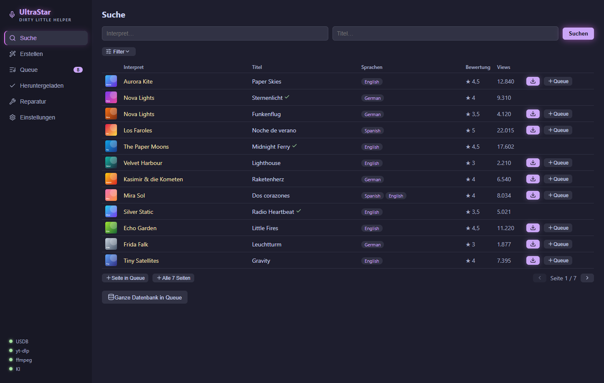
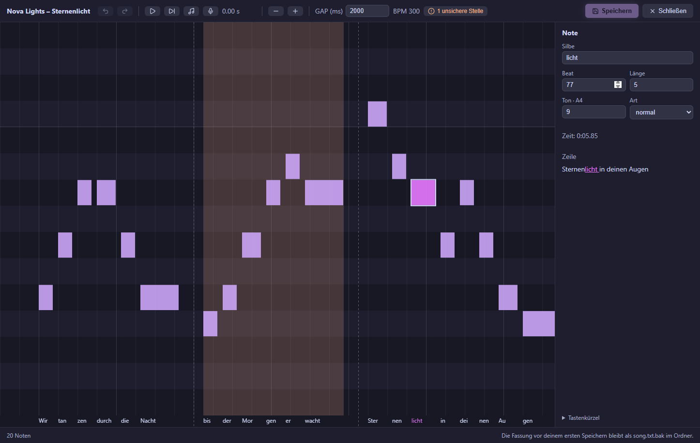
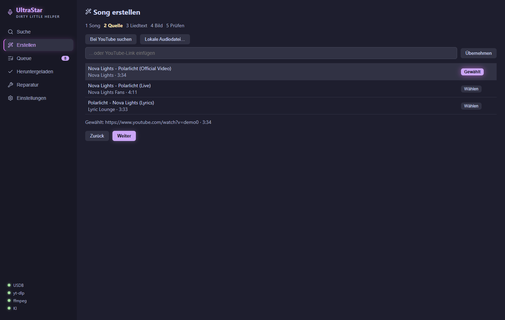
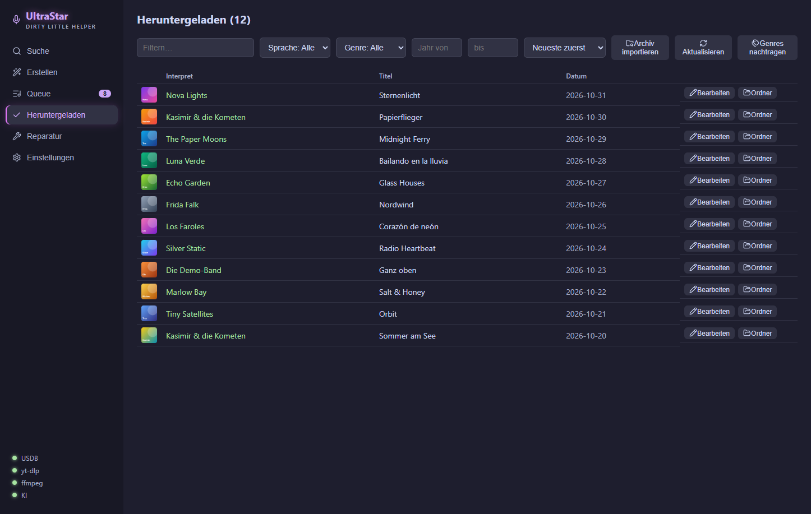
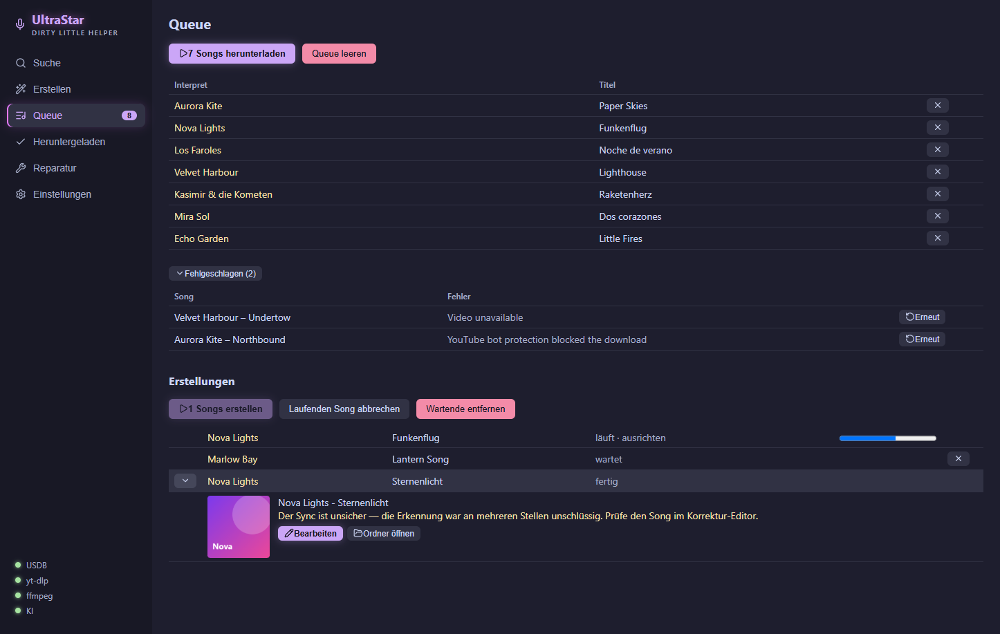

🇬🇧 [English](README.en.md) | 🇩🇪 Deutsch | 🇪🇸 [Español](README.es.md)

# UltraStar - Dirty Little Helper

**Die Desktop-App, die deine UltraStar-Karaoke-Sammlung aufbaut, pflegt und durchsuchbar macht — und aus jedem Lied einen singbaren Song erstellt.**

[](https://buymeacoffee.com/normanschou)

Durchsuche die größte UltraStar-Datenbank (USDB), lade komplette, sofort singbare Song-Ordner — Text, Cover und Video in einem Rutsch — und verwalte zehntausende Songs mit echten Filtern. Kein manuelles Zusammensuchen, keine kaputten Ordner. Suchen, laden, singen.

Dein Lieblingslied fehlt in der Datenbank? Dann **erstelle es selbst:** Die KI trennt die Stimme ab, legt den Text auf den Gesang und erkennt die Tonhöhen — heraus kommt ein fertiger Song mit Noten, den du im Editor noch nachschärfen kannst.

🎤 **Gebaut für [Melody Mania](https://store.steampowered.com/search/?term=Melody%20Mania) auf Steam** — und genauso für UltraStar Deluxe, Vocaluxe und UltraStar Play.

➡️ **Neu hier? [Zum Schritt-für-Schritt-Tutorial](docs/TUTORIAL.md)**



| Korrektur-Editor | Song erstellen |
| :---: | :---: |
|  |  |
| **Bibliothek** | **Queue mit Erstellungen** |
|  |  |

<sub>Die Bilder zeigen eine Demo-Bibliothek mit erfundenen Interpreten und Titeln.</sub>

---

## ✨ Funktionen

### Suchen & Herunterladen
- **USDB-Suche mit echten Filtern:** Sprache, Genre, Jahr, Golden Notes, Songcheck — serverseitig über die gesamte Datenbank, mit wählbarer Sortierung (zuletzt geändert, Interpret, Titel, Jahr, Bewertung, Views). Filteränderungen suchen automatisch neu.
- **Bestands-Abgleich direkt in der Suche:** Bereits vorhandene Songs sind markiert (✓) und werden bei Massen-Downloads automatisch übersprungen — auch importierte Bestände. Umschaltbar: alle / nur fehlende / nur vorhandene Treffer anzeigen.
- **Massen-Downloads:** Einzelsong, ganze Ergebnisseite, alle Seiten einer Suche oder die komplette Datenbank in die Queue — mit Fortschritt, Abbruch, Wiederaufnahme nach Absturz und Retry fehlgeschlagener Downloads.
- **Cover-Vorschau** in Suchergebnissen und Bibliothek (inkl. lokaler Cover importierter Songs).
- **VIDEOGAP-Korrekturen aus USDB-Kommentaren** werden automatisch übernommen — Videos laufen synchron zum Text.

### Songs erstellen
- **Fünf-Schritte-Assistent:** Aus einem beliebigen Titel einen singbaren Song bauen — Quelle wählen (YouTube-Suche, Link oder lokale Datei), Text holen, Cover aussuchen, prüfen, fertig.
- **KI-Pipeline im Hintergrund:** Ein Python-Sidecar trennt die Stimme ab, transkribiert sie, richtet den Text am Gesang aus und erkennt die Tonhöhen — daraus entsteht eine vollständige `song.txt` mit Noten.
- **Eigene Warteschlange:** Erstellungen laufen neben den Downloads, mit Fortschritt, Abbruch und direktem Sprung in den fertigen Ordner.
- **Einmalige Einrichtung:** Die KI-Umgebung (Python, Torch, Modelle) installiert die App auf Knopfdruck selbst — mit GPU-Erkennung, falls vorhanden.
- **Korrektur-Editor:** Noten, Silben und Timing jedes Songs — selbst erstellt oder heruntergeladen — in einer Piano-Roll-Ansicht mit Wiedergabe gerade ziehen — mit markierten unsicheren Stellen bei selbst erstellten Songs, Tonhöhen-Korrektur per Einsingen ins Mikrofon (die Verzögerung von Mikrofon und Einsatz misst der Editor selbst und gleicht sie aus) und Duett-Unterstützung. Die ursprüngliche Fassung bleibt als `song.txt.bak` erhalten; ändert ein anderes Programm die Datei, während der Editor offen ist, wählst du zwischen Neu laden und Überschreiben.

### Bibliothek
- **Archiv-Import:** Bestehende Sammlungen (auch zehntausende Songs, auch verschachtelte Ordnerstrukturen) ohne erneute Downloads übernehmen — inklusive Metadaten aus den song.txt-Dateien.
- **Facetten-Filter:** Sprache, Genre, Jahr-Bereich und Textsuche kombinierbar; Dropdown-Zähler passen sich der aktuellen Auswahl an; mehrsprachige Songs erscheinen unter jeder ihrer Sprachen. Sortierung A–Z, nach Jahr oder Neueste zuerst. Endloses Scrollen statt Seitenlimits.
- **Genre-Anreicherung:** Fehlende Genres (und Jahre) per Online-Datenbank nachtragen — wählbar Deezer (ohne Anmeldung), Last.fm (API-Key) oder MusicBrainz. Läuft im Hintergrund, ist jederzeit abbrechbar und macht beim nächsten Start nahtlos weiter. Schreibt auf Wunsch direkt in die song.txt-Dateien (#GENRE).
- **Video-Reparatur:** Findet fehlende/defekte Videos und lädt gezielt nur diese nach — Metadaten bleiben unangetastet.

### Komfort
- **Alles automatisch:** USDB-Konto, yt-dlp und ffmpeg richtet die App selbst ein — kein manuelles Setup nötig.
- **Konfigurierbar:** Ordnerstruktur neuer Downloads (flach, nach Interpret, nach Anfangsbuchstabe), Download-Parallelität (1–5), maximale Video-Qualität (720p/1080p/beste), YouTube-Cookie-Browser.
- **Automatische Updates:** Die App meldet neue Versionen selbst und installiert sie auf Knopfdruck — kein manuelles Nachladen mehr.
- **Drei Sprachen:** Oberfläche auf Deutsch, Englisch oder Spanisch — umschaltbar in den Einstellungen.
- **Duplikatschutz über Sitzungen hinweg**, Fehl-Download-Protokoll als Excel-Datei, dunkles Design.

---

## 🚀 Installation (Windows)

1. Neueste `UltraStar-DLH-Setup-*.exe` von den [GitHub Releases](https://github.com/normannormalmann/ultrastar-dlh/releases) herunterladen.
2. Ausführen. Windows SmartScreen warnt bei unsignierten Apps — **„Weitere Informationen" → „Trotzdem ausführen"**.
3. Fertig. Beim ersten Start lädt die App yt-dlp und ffmpeg automatisch herunter und legt ein USDB-Konto an.

Ab dann meldet sich die App selbst, wenn eine neue Version vorliegt: **Einstellungen → App → „Auf Updates prüfen"**, herunterladen, neu starten. Weil der Installer nicht signiert ist, fragt SmartScreen auch beim Update noch einmal nach.

Für Linux liegt ein `UltraStar-DLH-*.AppImage` bei — ausführbar machen und starten.

Ausführliche Einrichtung inkl. Archiv-Import: **[Tutorial](docs/TUTORIAL.md)**

---

## 🖥️ Terminal-Version (CLI/TUI)

Für Server, Power-User und macOS/Linux gibt es weiterhin die Terminal-Oberfläche mit demselben Kern (Suche, Queue, Reparatur):

```bash
# Voraussetzungen: yt-dlp, ffmpeg, Bun (https://bun.sh)
bunx --bun github:normannormalmann/ultrastar-dlh
```

| Kürzel | Aktion |
| :--- | :--- |
| `Tab` / `Enter` | Feld wechseln / Suchen |
| `↑↓` `←→` | Song wählen / Seite blättern |
| `Enter` | Sofort herunterladen |
| `Ctrl+Q` / `Ctrl+A` / `Ctrl+P` | Song / Seite / alle Seiten in die Queue |
| `Ctrl+D` | Queue starten |
| `Ctrl+V` | Reparatur-Modus |
| `Ctrl+F` | Fehlgeschlagene Downloads anzeigen (Retry mit `Enter`) |
| `Ctrl+S` | Setup (Pfad, Cookie-Browser) |
| `Esc` | Zurück / Beenden |

---

## 🛠️ Wie es funktioniert

1. **Suche:** Die App authentifiziert sich bei USDB und fragt die Datenbank ab.
2. **Auflösen:** Video-Links kommen aus den USDB-Kommentaren (inkl. dort hinterlegter VIDEOGAP-Korrekturen); fehlt einer, sucht die App gezielt auf YouTube.
3. **Laden:** Video/Audio via `yt-dlp` in der konfigurierten Qualität, zusammengeführt mit `ffmpeg`.
4. **Zusammensetzen:** Cover und Songtext werden geholt und als standardkonforme `song.txt` abgelegt — kompatibel mit Melody Mania, UltraStar Deluxe, Vocaluxe und UltraStar Play.
5. **Verfolgen:** Erfolge und Fehlschläge werden lokal protokolliert (`downloaded.json`, `failed-downloads.xlsx`) — für Duplikatschutz und einfache Retries.

---

## 👨‍💻 Entwicklung

Das Projekt nutzt Bun nativ (TypeScript, Effect, Electron + React, Ink für die TUI).

```bash
git clone https://github.com/normannormalmann/ultrastar-dlh.git
cd ultrastar-dlh
bun install

bun run start          # TUI im Dev-Modus
bun run desktop:dev    # Desktop-App mit Hot Reload
bun run test           # Unit-Tests
bun run test:e2e       # Playwright-Smoke-Test (baut vorher)
bun run docs:screenshots  # Screenshots für README und Tutorial neu erzeugen (alle drei Sprachen)
bun run desktop:dist   # Installer für die aktuelle Plattform bauen (dist/)
bun run desktop:dist:win     # Windows-Installer erzwingen
bun run desktop:dist:linux   # Linux-AppImage erzwingen
bun run lint           # Biome
```

Architektur: `src/core/` (geteilter Kern: USDB-API, Downloads, Storage, Genre-Provider) ← `src/desktop/` (Electron: Main/Preload/Renderer mit typisiertem IPC-Vertrag) und `src/tui/` (Ink). Design-Dokumente unter `docs/superpowers/`.

### Security-Checks

Bun 1.4.3 verwenden und mit `bun install --frozen-lockfile` installieren. `bun audit --audit-level=high` und `bun audit --prod --audit-level=moderate` laufen in CI unabhängig voneinander. ZIP-Regressionstests laufen unter Windows und Linux; CodeQL analysiert TypeScript/JavaScript und Python.

Der Python-Audit prüft Basis- und Modellabhängigkeiten getrennt für Python 3.12 und berücksichtigt die Torch-Pins der automatischen Einrichtung. Aufgelöste Versionen und Befunde werden als Artefakte gespeichert. Die Modellbefunde bleiben blockierend; der [separate Migrationsplan](docs/superpowers/plans/2026-10-14-model-security-migration.md) beschreibt die nächsten Schritte.

---

## 🚨 Problemlösung

- **„Sign in to confirm you're not a bot" (YouTube-Bot-Schutz):** In den Einstellungen den Browser wählen, in dem du bei YouTube angemeldet bist — die App nutzt dessen Cookies. Browser vor dem Download schließen (sonst ist die Cookie-Datenbank gesperrt). Alternativ eine `cookies.txt` in den Songs-Ordner legen.
- **yt-dlp/ffmpeg fehlen:** Einstellungen → Tools → „Fehlende Tools automatisch installieren". Bei Problemen manuell installieren und in den PATH aufnehmen, dann App neu starten.
- **Songs erscheinen nicht in der Bibliothek:** Erst „Archiv importieren" (übernimmt Bestände), bei extern gelöschten/geänderten Ordnern „Aktualisieren" klicken.
- **Genre-Lauf bricht ab:** Einfach erneut starten — bereits angereicherte Songs werden übersprungen. Für hartnäckige Fälle die Quelle wechseln (Einstellungen → Genre-Quelle).

Mehr im **[Tutorial → Problemlösung](docs/TUTORIAL.md#11-problemlösung)**.

## ☕ Unterstützen

Die App ist kostenlos und ein Freizeitprojekt. Ein ⭐ auf GitHub hilft anderen, sie zu finden, und ein Kaffee hält die Entwicklung am Laufen:

[](https://buymeacoffee.com/normanschou)

## 🔗 Links & Credits

- [USDB (UltraStar Database)](https://usdb.animux.de) — die größte Datenbank für UltraStar-Songtexte
- [UltraStar Deluxe](https://github.com/UltraStar-Deluxe/USDX) — das Karaoke-Spiel
- Entstanden als Fork von [UltraScrap-cli](https://github.com/martiinii/UltraScrap-cli) von Marcin Gąsienica-Makowski — danke! 🙏

Lizenz: [MIT](LICENSE.md)
