🇩🇪 [Deutsch](TUTORIAL.md) | 🇬🇧 English | 🇪🇸 [Español](TUTORIAL.es.md)

# Tutorial: UltraStar - Dirty Little Helper

This tutorial takes you from installation to a well-kept karaoke library — step by step. No prior knowledge needed.

> The pictures show a demo library with made-up artists and titles. Your app looks exactly the same, just with your songs.

**Contents**
1. [Installing and first launch](#1-installing-and-first-launch)
2. [Basic settings](#2-basic-settings)
3. [Importing an existing collection](#3-importing-an-existing-collection)
4. [Searching for and downloading songs](#4-searching-for-and-downloading-songs)
5. [Bulk downloads with the queue](#5-bulk-downloads-with-the-queue)
6. [The library: filter, sort, find](#6-the-library-filter-sort-find)
7. [Filling in genres automatically](#7-filling-in-genres-automatically)
8. [Repairing videos](#8-repairing-videos)
9. [Creating songs yourself](#9-creating-songs-yourself)
10. [Fixing notes: the correction editor](#10-fixing-notes-the-correction-editor)
11. [Troubleshooting](#11-troubleshooting)

---

## 1. Installing and first launch

1. Download the latest `UltraStar-DLH-Setup-*.exe` from the [releases](https://github.com/normannormalmann/ultrastar-dlh/releases). For Linux there is an `UltraStar-DLH-*.AppImage` — make it executable and start it.
2. Run it. Windows SmartScreen shows a warning (the app is not signed): choose **"More info" → "Run anyway"**. The installation runs through without further questions and starts the app.
3. On the first launch, this happens by itself:
   - The app creates an anonymous **USDB account** and signs in.
   - If **yt-dlp** or **ffmpeg** are missing, the app downloads both itself. You do not have to do anything.

On the left is the sidebar with every section; at its bottom sit the **status dots**: USDB sign-in, yt-dlp, ffmpeg and AI (the AI environment for [creating your own songs](#9-creating-songs-yourself)). Green means ready, yellow means "still checking". The AI dot stays red until you set up the AI environment — you do not need it for searching and downloading, and the red dot does not get in the way there.

> **Updates:** the app tells you itself when a new version is out: **Settings → App → "Check for updates"**, download, **"Restart and install"**. Because the installer is unsigned, SmartScreen asks once more on update as well. Doing it by hand still works: install a new version straight over the old one — settings, library and queue are kept.

## 2. Basic settings

Open **Settings** (the cog in the sidebar):

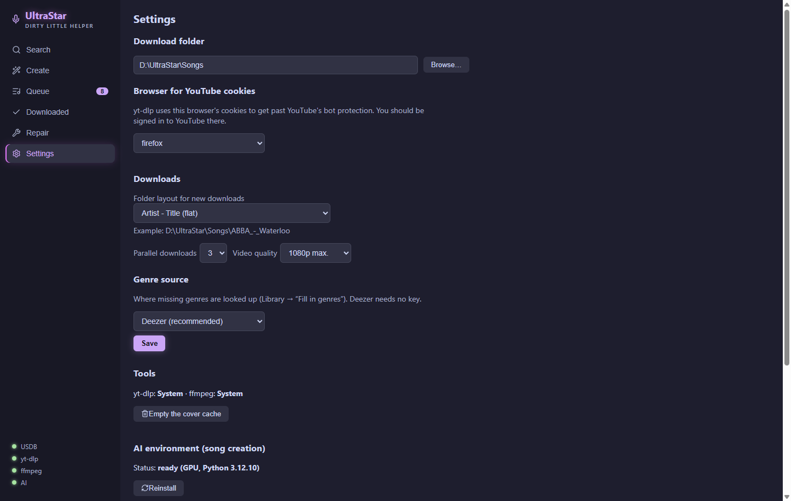

- **Download folder:** the folder your songs live in (or should live in) — e.g. `D:\UltraStar\Songs`. Pick it with "Browse…". *This is the same folder you add as a song folder in Melody Mania, or enter as SongDir in UltraStar Deluxe.*
- **Browser for YouTube cookies:** pick the browser you are **signed in** to YouTube with (e.g. Edge, Chrome or Firefox). YouTube often blocks anonymous downloads; with your browser cookies the app gets past that. Important while downloading: close the browser, otherwise its cookie database is locked.
- **Downloads:**
  - *Folder layout for new downloads* — how new songs are filed:
    - `Artist - Title` (flat): everything on one level — the default.
    - `Artist / Artist - Title`: one subfolder per artist.
    - `A / Artist - Title`: subfolders by first letter.
    The example line below shows the path live. UltraStar Deluxe copes with all variants (even mixed); songs you already have are never moved.
  - *Parallel downloads* (1–5): how many songs load at once. 2–3 is a good default.
  - *Video quality*: 720p max. saves space, 1080p max. is the default, "Best available" takes whatever YouTube offers.
- **Genre source:** see [chapter 7](#7-filling-in-genres-automatically).

**"Save"** below the genre source applies these settings — and the language as well (see below).

Further down are these sections:

- **Tools:** where yt-dlp and ffmpeg come from ("System" = already installed, "App-managed" = fetched by the app). If one is missing, **"Install the missing tools automatically"** gets it. **"Empty the cover cache"** deletes the cached preview images of the search.
- **AI environment (song creation):** status and setup, see [chapter 9](#9-creating-songs-yourself).
- **App:** the installed version and **"Check for updates"**.
- **Language:** German, English or Spanish. The interface switches right away; the choice is stored for good with "Save" further up. With no choice of your own the app follows your system language.

## 3. Importing an existing collection

Already have songs on disk? Import them first — otherwise the app does not know what you own and would download songs twice.

1. Make sure the **download folder** (chapter 2) points at your collection.
2. Open **Downloaded** in the sidebar → click **"Import archive"**.
3. The app scans every song folder (nested one level too, e.g. `ABBA\ABBA - Waterloo\`) and takes in every folder holding a `song.txt` — **without downloading anything**. On large collections (10,000+) this takes a few minutes; a progress bar shows where it is.
4. Read the result message: "N songs imported (N of them without a video — run the repair) · M already present". Songs **without a video** only appear in the list after a [repair](#8-repairing-videos), but they are already protected against double downloads.

**Worth knowing:**
- The import reads language, genre, year and the rest straight from the song.txt files — your filters work immediately.
- Clicking "Import archive" **again** never hurts: it finds new folders and fills in missing metadata on entries already imported.
- Deleted or changed folders outside the app? Click **"Refresh"** — the app re-checks what is on disk.

## 4. Searching for and downloading songs

1. Open **Search** (the magnifier). Enter artist and/or title, press `Enter` or "Search".
2. The table shows cover, artist, title, languages, rating (★) and views. Songs you already own carry a green **✓** — nothing to do for those.

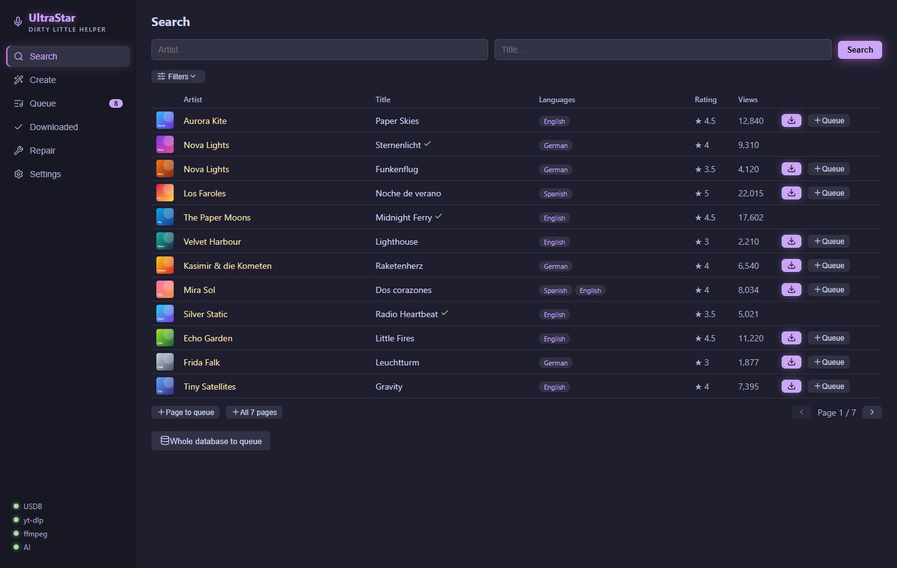

3. Unfold **Filters** (the slider icon) for more control:
   - **Language, genre, year** — filtered on the server across the *whole* database, not just the current page.
   - **Sort order** plus direction (e.g. "Rating descending" for the most popular first).
   - **Golden notes only / Songcheck only** — quality markers from the database.
   - **Library:** "Only missing" hides what you already have — perfect for browsing for something new.
   - Changing a filter searches again by itself (a small counter on the filter button shows the active ones).

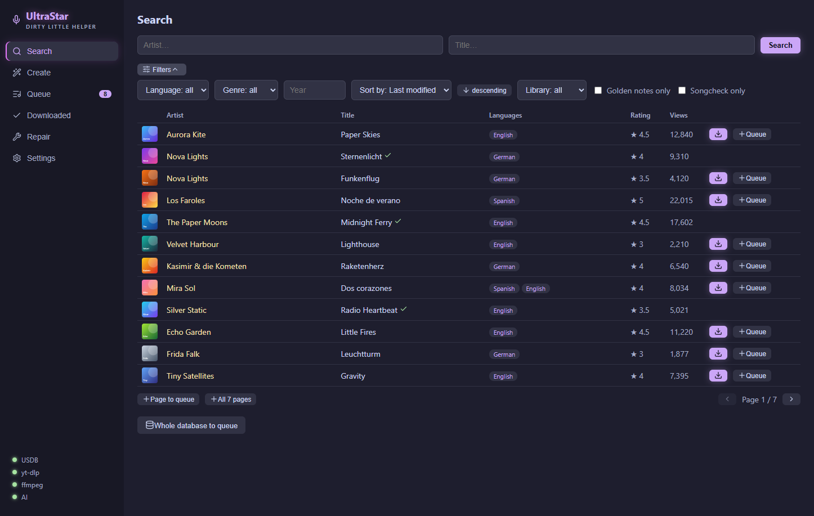

4. **Downloading:** the ⬇ button on the row fetches the song right away. The download bar appears at the bottom with progress. A complete song (lyrics + cover + video) usually takes under a minute, depending on the video.

The finished song then sits as a folder in your download folder — with `song.txt`, `cover.jpg` and `video.mp4` — and is immediately singable in UltraStar Deluxe (re-read the songs there if needed).

## 5. Bulk downloads with the queue

For anything beyond a handful of songs:

1. Collect them in the search:
   - **"＋ Queue"** on the row: a single song.
   - **"＋ Page to queue"**: every (visible) hit on the current page.
   - **"＋ All N pages"**: *every* page of the current search — e.g. all of "Language: German, Genre: Schlager". It respects every active filter.
   - **"Whole database to queue"**: literally everything (tens of thousands of songs — with a confirmation dialog).
   Songs you already own or already queued are skipped automatically; the counter next to "Queue" in the sidebar grows accordingly.
2. Open **Queue** → **"▶ Download N songs"**. The app works through the list at the parallelism you set.

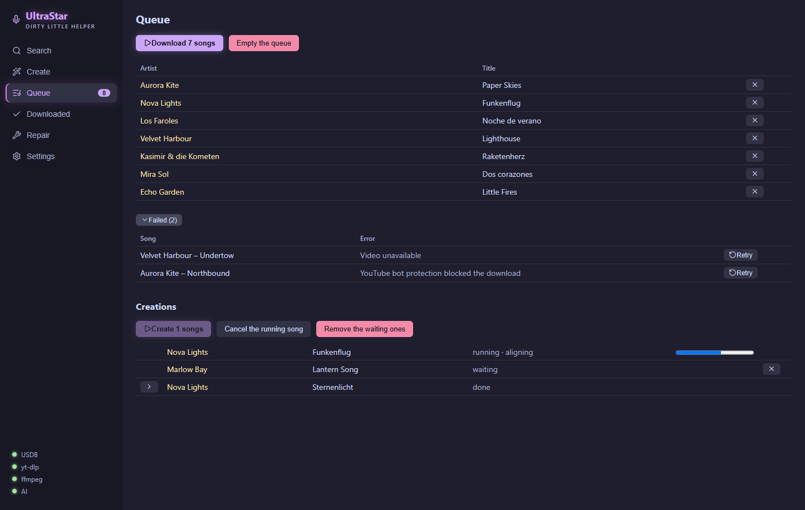

3. You can **cancel** at any time (after the batch in flight) — the queue is saved, across app restarts and crashes alike. "▶" simply carries on later.
4. **Failed downloads** land in the collapsible area below (most common cause: YouTube bot protection → see [troubleshooting](#11-troubleshooting)). "↻ Retry" puts them back in the queue; there is also a `failed-downloads.xlsx` in the songs folder with all the details.

Below the downloads is the **Creations** section for songs you build yourself — more on that in [chapter 9](#9-creating-songs-yourself).

## 6. The library: filter, sort, find

**Downloaded** is your view of what you own:

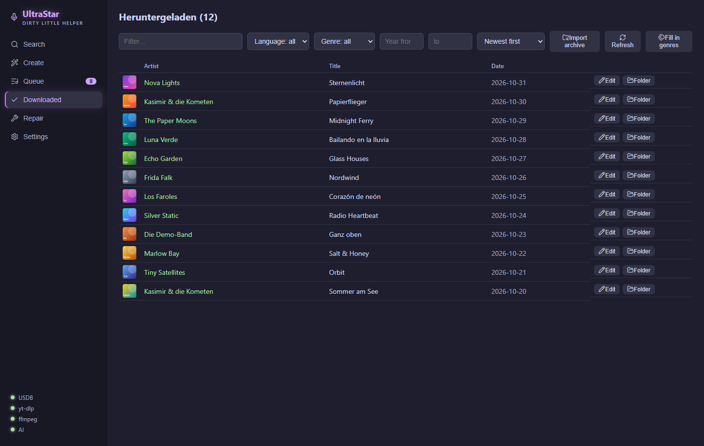

- The **text filter** searches artist and title.
- **Language/genre dropdowns** only offer values that fit the rest of your selection — with hit counts. Songs in several languages ("Japanese, German") appear under each.
- **Year from/to** narrows down periods ("just the 80s": 1980–1989).
- **Sorting:** newest first, artist A–Z, title A–Z, year ascending.
- The list loads more as you scroll ("showing X of Y").
- **"Edit"** on each row opens the song in the [correction editor](#10-fixing-notes-the-correction-editor), **"Folder"** opens it in Explorer.
- **"Refresh"** reconciles the list with what is actually on disk (e.g. after deleting something by hand).

## 7. Filling in genres automatically

Many USDB songs arrive with no genre — which leaves your filters just as empty. The app can fill in missing genres (and years) from online music databases:

1. Pick a **Settings → Genre source** and save:
   - **Deezer** (recommended): no sign-up, a good hit rate, roughly 1–2 hours for 10,000 songs.
   - **Last.fm**: the best genre variety, needs a free [API key](https://www.last.fm/api/account/create) (the field appears once you pick it).
   - **MusicBrainz**: an open database that finds partly different songs — but is limited to one request per second (and is slow accordingly).
2. **Downloaded → "Fill in genres"**. Progress: "Looking up genres… (x/y · z found)".
3. You can **cancel at any time** — the state is saved, and the next run skips songs already enriched. Downloading alongside the run is no problem.
4. Genres that are found get normalised (a consistent "Hip-Hop" instead of "rap/hip hop" and so on), written into the library **and** as `#GENRE:` into the respective song.txt — so they are visible in UltraStar Deluxe too.

**Tip for maximum coverage:** first a full Deezer run, then switch the source to MusicBrainz and run again — the second run only tries the songs left over and often finds more. Whatever is still missing usually simply does not exist in those databases (remixes, niche titles) — you can add those by hand in the song.txt if you care to.

## 8. Repairing videos

When videos are missing or broken (aborted downloads, deleted files, imported collections without video):

1. **Repair** in the sidebar → **"Start scan"**.
2. The app searches the download folder for songs with a missing or suspiciously small `video.mp4` and re-downloads **the videos only** — lyrics and covers are left alone. Songs without a tracking entry are reconstructed along the way.
3. The closing report shows repaired / reconstructed / beyond repair. Songs beyond repair are grouped by cause, each with a hint on what helps. Freshly repaired songs then appear in the library.

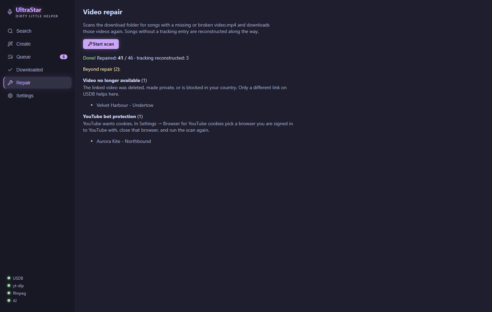

The same applies here: if the USDB comments hold a VIDEOGAP correction for the video, the app carries it into the song.txt automatically.

## 9. Creating songs yourself

A song is missing from USDB? The app builds it for you — from a recording and the lyrics. An AI separates the vocals, recognises the sung words, places them at the right moments and determines the pitches. The result is an ordinary song folder with `song.txt`, audio and cover.

**Once: set up the AI environment**
1. **Settings → AI environment (song creation) → "Set up the AI environment (~8 GB)"**. The app downloads Python, Torch and the models itself and checks whether a graphics card can be used. Depending on your connection this takes a while — progress is shown next to it.
2. The **"AI"** dot at the bottom left of the sidebar turns green once everything is in place. It also works without a graphics card, just much more slowly.

**A song in five steps** — **Create** in the sidebar:

1. **Song:** artist, title and language (required), plus genre, year and BPM if you like. Leave BPM empty if you don't know it — the pipeline works out the tempo itself.

   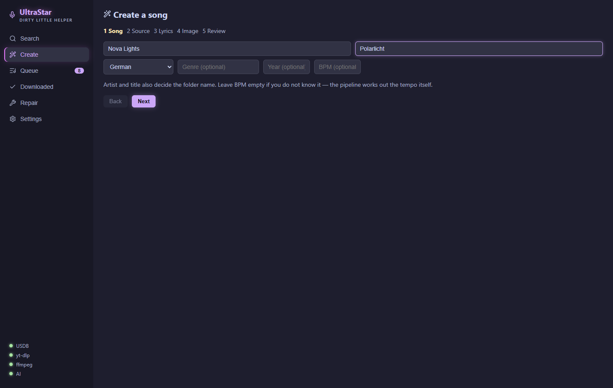

2. **Source:** "Search YouTube" shows five hits with their duration. "Choose" takes one of them. Alternatively paste a YouTube link and click "Apply", or pick a **local audio file**.

   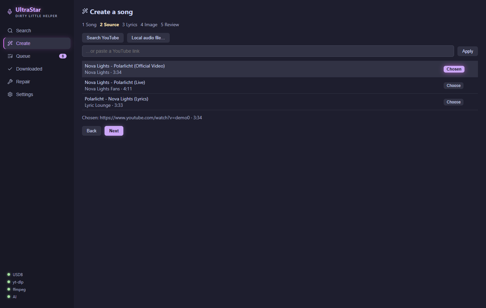

3. **Lyrics:** "Look on LRCLIB" fetches the lyrics with timestamps if they exist — that noticeably improves the timing. Otherwise paste the lyrics by hand: one line per sung phrase, blank lines separate blocks. The app asks when something is unclear (e.g. "2x" at the end of a line or a bare chorus reference).

   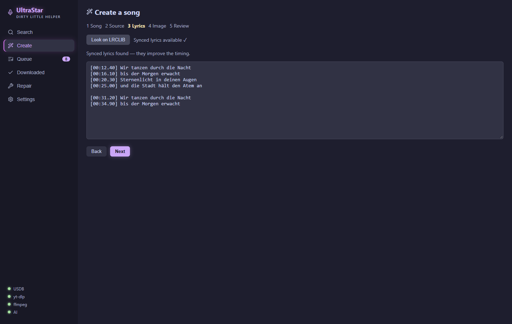

4. **Image:** album cover, YouTube image, your own file — or deliberately "No image".

   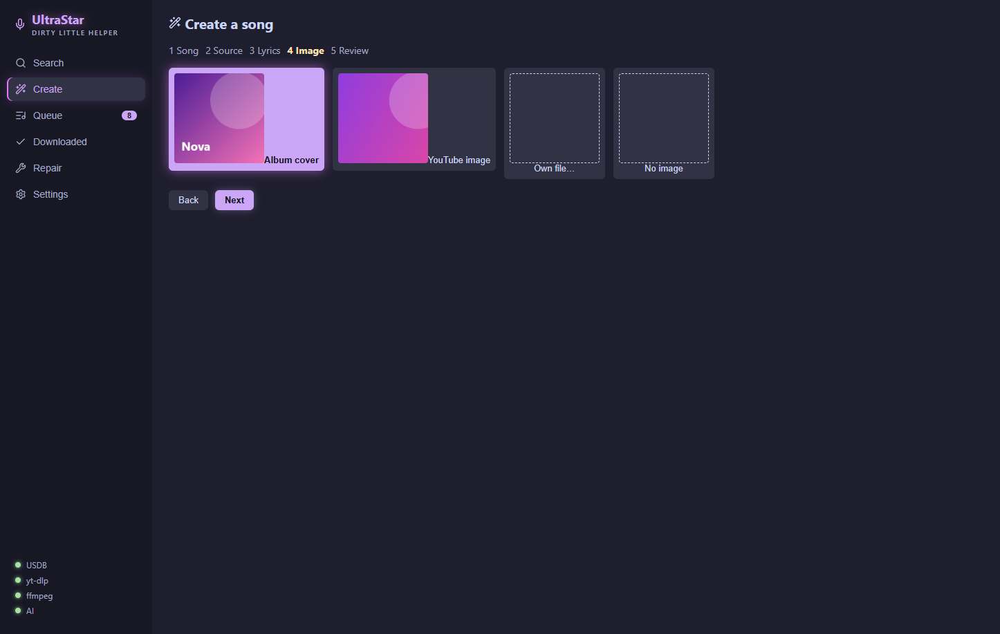

5. **Review:** check the summary, **"Add to queue"**. If a song of the same name is already in the library, the app says so; the new folder then goes next to it and the old one stays untouched.

   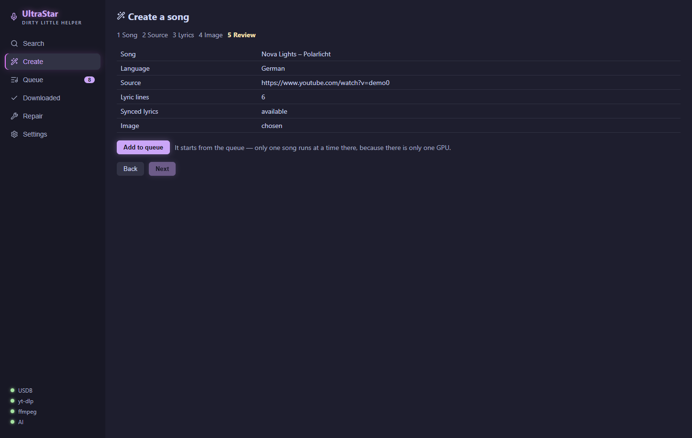

Creations start in the **Queue**, section **"Creations"**: **"▶ Create N songs"**. Only one song runs at a time, with progress per stage (separate, recognise, align, pitch …). "Cancel the running song" stops only the current one; the queue carries on with the next. Once a song is finished, the arrow on the row opens the details: cover, **"Edit"** in the correction editor and **"Open folder"**.

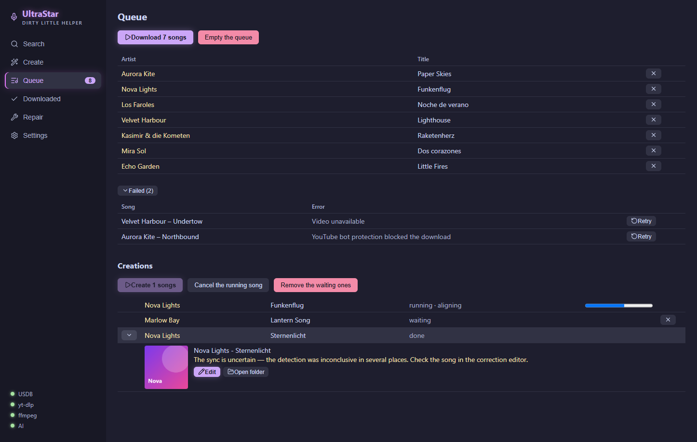

> **To be honest:** an AI creation is a good first draft, not finished USDB quality. If the app says *"The sync is uncertain"*, the detection was inconclusive in several places — then it is worth a look in the [correction editor](#10-fixing-notes-the-correction-editor).

## 10. Fixing notes: the correction editor

The editor straightens out the timing, pitches and syllables of a song — whether you created it or downloaded it. To open it: **"Edit"** on a row in **Downloaded**, or in the details of a finished creation.

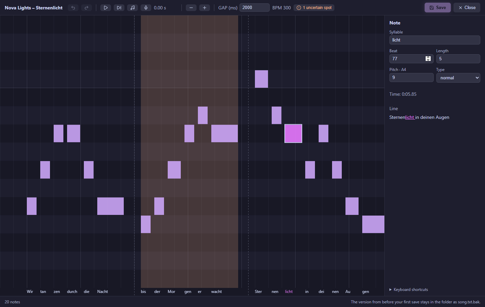

**What you see:** the toolbar at the top (undo, play, play line, play note tones, sing in, zoom, GAP), the notes as bars in the middle — time from left to right, pitch from bottom to top, syllables underneath. Dashed lines are line breaks, the green line is the playback position. On the right are the values of the selected note (syllable, beat, length, pitch, type, time) and its whole lyric line with the selected syllable highlighted.

**How to fix typical mistakes:**
- **Everything from some point on is early or late:** select the note, **Ctrl + Shift + ← / →** moves it and everything after it. With the mouse: drag the note while holding **Shift**.
- **The whole song is off:** adjust the **GAP** at the top (in milliseconds). It moves all notes at once.
- **A pitch is wrong:** **↑ / ↓** (with Shift by an octave). With **"Play note tones"** (note icon or **T**) you hear the note pitches on top of the original during playback — a wrong one stands out immediately. Or [sing the line in](#singing-in).
- **Wrong syllable:** press **E**, type, **Enter**.
- **Note too long or too short:** **Ctrl + ← / →**, or drag its right edge with the mouse.
- **Two syllables on one note / one syllable on two notes:** **S** splits, **M** merges with the next one.

To check: **P** plays the line of the selected note, **Space** plays from the playback position (a click on empty space sets it). Notes outlined in red overlap the one before — usually a slip. All shortcuts are listed in the editor under **"Keyboard shortcuts"**.

**Save** with the button or **Ctrl + S**. On the first save the editor puts the original version into the song folder as `song.txt.bak`; later saves do not overwrite it. To go back to the original, just rename it back.

**File changed elsewhere in the meantime?** If another program (or filling in genres) changed the `song.txt` while the editor was open, the editor does not simply save over it. Instead a bar offers three ways out:

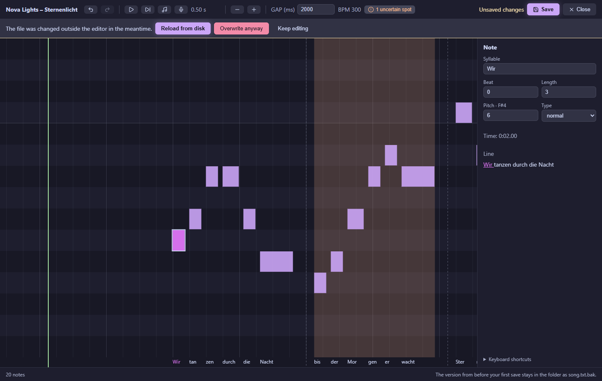

- **"Reload from disk"** takes the newer version from disk. Your unsaved changes in the editor are lost.
- **"Overwrite anyway"** writes your version over the newer file. The other program's changes are lost.
- **"Keep editing"** closes the bar without doing anything — e.g. to look first at what changed.

**Uncertain spots (created songs only):** where the detection had doubts, an orange band lies behind the notes — strong where the timing was only estimated, faint where the measurement was weak. A button at the top shows how many spots are left. **U** jumps to the next one, **K** marks it as checked. Checked spots are gone for good. These markers only exist for songs created with version 1.5 or newer.

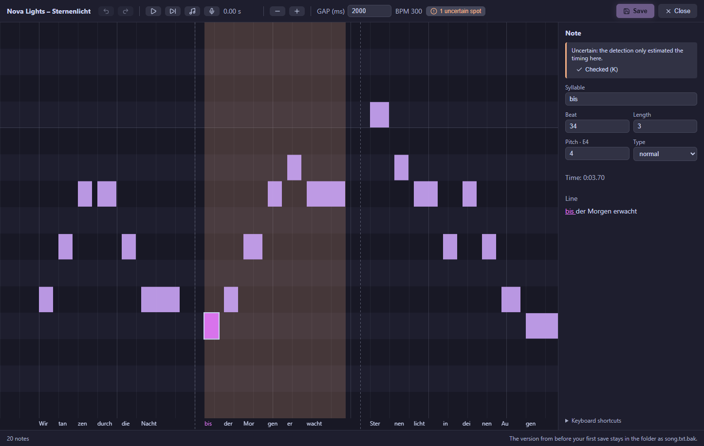

**Singing in:** select a note, press **I** (or the microphone icon) and sing along with the line. After a short lead-in the editor plays the line and listens through the microphone. Afterwards it shows the line you sang (green) and the suggested pitches as dashed outlines. **Enter** applies them in one step, **Esc** discards them, "Again" starts over.

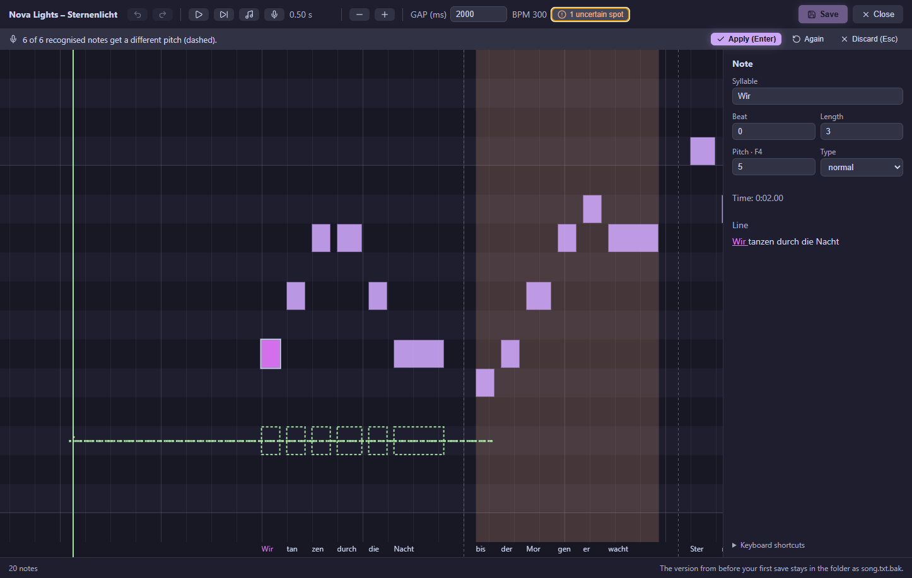

Good to know:
- If you sing in a different register than the original (e.g. an octave lower), the editor compensates — the melody counts, not the octave.
- **Delay:** microphone, speakers and your own reaction make your singing arrive a little later than the notes are placed. The editor measures this offset from your take itself and compensates for it. When it finds one, the bar says so, e.g. "You were 120 ms behind the music — compensated."
- Only notes you sang clearly are changed; the rest stays as it is.
- Use **headphones**, otherwise the microphone hears the original too.

**Duets:** songs with two voices (`P1`/`P2`) get tabs with the singers' names above the notes; **Tab** switches voice. The other voice is shown faintly in the background.

**Good to know:** files in `RELATIVE` format are written back in the same format. Older files encoded as Windows-1252 are converted to UTF-8 on save.

## 11. Troubleshooting

**"YouTube bot protection blocked the download" / many failures in a row**
YouTube is blocking anonymous downloads. The fix: in the settings, pick the browser you are **signed in** to YouTube with, **close** that browser, then try again ("↻ Retry" on the failed ones). For stubborn cases: put a `cookies.txt` (browser extension "Get cookies.txt") into the songs folder.

**The yt-dlp/ffmpeg status dot stays red**
Settings → Tools → "Install the missing tools automatically". If that fails too (corporate proxy or similar): install [yt-dlp](https://github.com/yt-dlp/yt-dlp#installation) and [ffmpeg](https://www.gyan.dev/ffmpeg/builds/) by hand, add them to your PATH, restart the app.

**The AI status dot is red or yellow**
Red means: not set up, or broken. Not set up is normal as long as you do not want to create songs yourself ([chapter 9](#9-creating-songs-yourself)). If the setup failed at some step, Settings → AI environment shows the last error; "Try again" or "Reinstall" sets it up afresh. Yellow means: outdated — after an app update the environment needs an update too: Settings → AI environment → "Update now".

**Song downloaded, but the video runs out of sync with the lyrics**
Delete the song folder, click "Refresh" in the library, download the song again — the app carries VIDEOGAP corrections over from the USDB comments automatically. If the offset is in the lyrics themselves, the **GAP** in the [correction editor](#10-fixing-notes-the-correction-editor) helps.

**The library still shows deleted songs / new folders are missing**
"Refresh" in the library (reconciles with the disk) or "Import archive" (picks up new folders).

**The import says "X without a video"**
Normal for collections with missing videos. Those songs are tracked (no double download) but only appear in the list after a [repair](#8-repairing-videos).

**Singing in: "No microphone available"**
Check that a microphone is connected and that Windows allows access: Windows Settings → Privacy → Microphone.

**The app asks for a Last.fm key**
Only the Last.fm source needs one — free at [last.fm/api/account/create](https://www.last.fm/api/account/create), or simply stay with Deezer.

---

Questions, bugs, wishes? → [GitHub Issues](https://github.com/normannormalmann/ultrastar-dlh/issues)
