🇩🇪 [Deutsch](TUTORIAL.md) | 🇬🇧 [English](TUTORIAL.en.md) | 🇪🇸 Español

# Tutorial: UltraStar - Dirty Little Helper

Este tutorial te lleva desde la instalación hasta una colección de karaoke bien cuidada — paso a paso. No hacen falta conocimientos previos.

> Las imágenes muestran una colección de demostración con intérpretes y títulos inventados. Tu aplicación se ve exactamente igual, solo que con tus canciones.

**Contenido**
1. [Instalación y primer arranque](#1-instalación-y-primer-arranque)
2. [Ajustes básicos](#2-ajustes-básicos)
3. [Importar una colección existente](#3-importar-una-colección-existente)
4. [Buscar y descargar canciones](#4-buscar-y-descargar-canciones)
5. [Descargas masivas con la cola](#5-descargas-masivas-con-la-cola)
6. [La colección: filtrar, ordenar, encontrar](#6-la-colección-filtrar-ordenar-encontrar)
7. [Completar géneros automáticamente](#7-completar-géneros-automáticamente)
8. [Reparar vídeos](#8-reparar-vídeos)
9. [Crear canciones tú mismo](#9-crear-canciones-tú-mismo)
10. [Corregir notas: el editor de corrección](#10-corregir-notas-el-editor-de-corrección)
11. [Solución de problemas](#11-solución-de-problemas)

---

## 1. Instalación y primer arranque

1. Descarga el `UltraStar-DLH-Setup-*.exe` más reciente desde las [releases](https://github.com/normannormalmann/ultrastar-dlh/releases). Para Linux hay un `UltraStar-DLH-*.AppImage`: dale permiso de ejecución y ábrelo.
2. Ejecútalo. Windows SmartScreen muestra un aviso (la aplicación no está firmada): elige **«Más información» → «Ejecutar de todas formas»**. La instalación continúa sin más preguntas e inicia la aplicación.
3. En el primer arranque ocurre solo:
   - La aplicación crea una **cuenta de USDB** anónima e inicia sesión.
   - Si faltan **yt-dlp** o **ffmpeg**, la aplicación descarga ambos por su cuenta. No tienes que hacer nada.

A la izquierda está la barra lateral con todas las secciones; abajo del todo, los **puntos de estado**: sesión de USDB, yt-dlp, ffmpeg e IA (el entorno de IA para [crear tus propias canciones](#9-crear-canciones-tú-mismo)). Verde significa listo, amarillo «todavía comprobando». El punto de IA sigue en rojo hasta que configures el entorno de IA; para buscar y descargar no lo necesitas, y el punto rojo no molesta.

> **Actualizaciones:** la aplicación te avisa por sí sola cuando hay una versión nueva: **Ajustes → Aplicación → «Buscar actualizaciones»**, descargar y **«Reiniciar e instalar»**. Como el instalador no está firmado, SmartScreen vuelve a preguntar también al actualizar. A mano sigue funcionando: instala la versión nueva encima de la antigua — los ajustes, la colección y la cola se conservan.

## 2. Ajustes básicos

Abre **Ajustes** (el engranaje de la barra lateral):

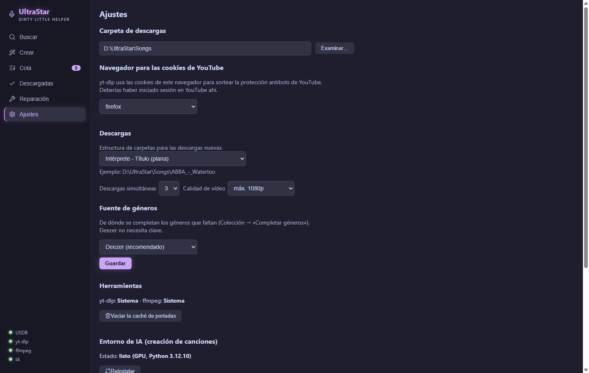

- **Carpeta de descargas:** la carpeta donde están (o estarán) tus canciones — p. ej. `D:\UltraStar\Songs`. Se elige con «Examinar…». *Es la misma carpeta que añades como carpeta de canciones en Melody Mania o indicas como SongDir en UltraStar Deluxe.*
- **Navegador para las cookies de YouTube:** elige el navegador en el que hayas **iniciado sesión** en YouTube (p. ej. Edge, Chrome o Firefox). YouTube bloquea a menudo las descargas anónimas; con las cookies de tu navegador la aplicación lo sortea. Importante al descargar: cierra el navegador, si no su base de datos de cookies queda bloqueada.
- **Descargas:**
  - *Estructura de carpetas para las descargas nuevas* — cómo se guardan las canciones nuevas:
    - `Intérprete - Título` (plana): todo en un solo nivel — la opción por defecto.
    - `Intérprete / Intérprete - Título`: una subcarpeta por intérprete.
    - `A / Intérprete - Título`: subcarpetas por letra inicial.
    La línea de ejemplo de debajo muestra la ruta en vivo. UltraStar Deluxe funciona con todas las variantes (incluso mezcladas); las canciones que ya tienes no se mueven.
  - *Descargas simultáneas* (1–5): cuántas canciones se cargan a la vez. 2–3 es un buen valor.
  - *Calidad de vídeo*: máx. 720p ahorra espacio, máx. 1080p es lo predeterminado y «La mejor disponible» coge lo que YouTube ofrezca.
- **Fuente de géneros:** ver el [capítulo 7](#7-completar-géneros-automáticamente).

**«Guardar»**, debajo de la fuente de géneros, aplica estos ajustes — y también el idioma (ver más abajo).

Más abajo están estas secciones:

- **Herramientas:** de dónde vienen yt-dlp y ffmpeg («Sistema» = ya instalado, «Gestionada por la app» = descargado por la aplicación). Si falta alguno, **«Instalar automáticamente las herramientas que faltan»** lo trae. **«Vaciar la caché de portadas»** borra las miniaturas guardadas de la búsqueda.
- **Entorno de IA (creación de canciones):** estado y configuración, ver el [capítulo 9](#9-crear-canciones-tú-mismo).
- **Aplicación:** la versión instalada y **«Buscar actualizaciones»**.
- **Idioma:** alemán, inglés o español. La interfaz cambia al momento; la elección se guarda de forma permanente con «Guardar» más arriba. Si no eliges nada, la aplicación sigue el idioma de tu sistema.

## 3. Importar una colección existente

¿Ya tienes canciones en el disco? Impórtalas primero — si no, la aplicación no sabe qué tienes y descargaría canciones dos veces.

1. Asegúrate de que la **carpeta de descargas** (capítulo 2) apunta a tu colección.
2. Abre **Descargadas** en la barra lateral → pulsa **«Importar colección»**.
3. La aplicación recorre todas las carpetas de canciones (también anidadas un nivel, p. ej. `ABBA\ABBA - Waterloo\`) y toma cada carpeta que tenga un `song.txt` — **sin descargar nada**. En colecciones grandes (más de 10 000) tarda unos minutos; una barra de progreso muestra por dónde va.
4. Lee el mensaje del resultado: «N canciones importadas (N de ellas sin vídeo — ejecuta la reparación) · M ya estaban». Las canciones **sin vídeo** solo aparecen en la lista tras una [reparación](#8-reparar-vídeos), pero ya están protegidas contra descargas duplicadas.

**Conviene saber:**
- La importación lee el idioma, el género, el año y lo demás directamente de los archivos song.txt — tus filtros funcionan de inmediato.
- Volver a pulsar «Importar colección» nunca hace daño: encuentra carpetas nuevas y completa los metadatos que falten en entradas ya importadas.
- ¿Has borrado o cambiado carpetas fuera de la aplicación? Pulsa **«Actualizar»** — la aplicación vuelve a comprobar lo que hay en el disco.

## 4. Buscar y descargar canciones

1. Abre **Buscar** (la lupa). Escribe intérprete o título, pulsa `Intro` o «Buscar».
2. La tabla muestra portada, intérprete, título, idiomas, valoración (★) y visitas. Las canciones que ya tienes llevan un **✓** verde — con esas no hay nada que hacer.

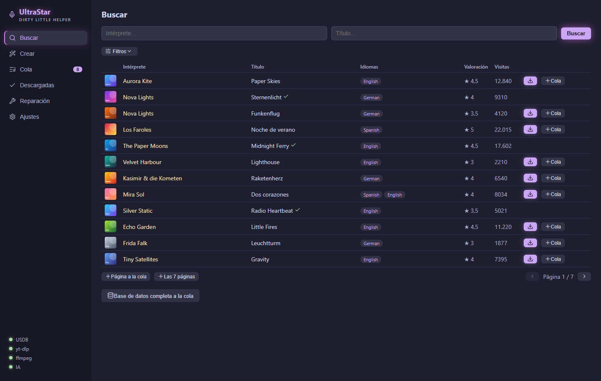

3. Despliega los **Filtros** (el icono de deslizadores) para tener más control:
   - **Idioma, género, año** — se filtran en el servidor sobre *toda* la base de datos, no solo la página actual.
   - **Ordenación** y sentido (p. ej. «Valoración descendente» para las más populares primero).
   - **Solo golden notes / Solo songcheck** — marcas de calidad de la base de datos.
   - **Colección:** «Solo las que faltan» oculta lo que ya tienes — perfecto para buscar novedades.
   - Cambiar un filtro vuelve a buscar por sí solo (un contador junto al botón de filtros muestra los activos).

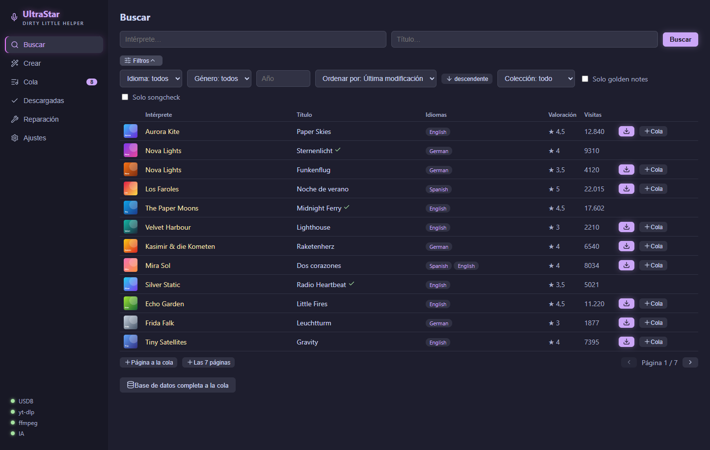

4. **Descargar:** el botón ⬇ de la fila descarga la canción al instante. Abajo aparece la barra de descargas con el progreso. Una canción completa (letra + portada + vídeo) suele tardar menos de un minuto, según el vídeo.

La canción terminada queda como carpeta dentro de tu carpeta de descargas — con `song.txt`, `cover.jpg` y `video.mp4` — y se puede cantar de inmediato en UltraStar Deluxe (allí, si hace falta, vuelve a leer las canciones).

## 5. Descargas masivas con la cola

Para todo lo que pase de unas pocas canciones:

1. Reúnelas desde la búsqueda:
   - **«＋ Cola»** en la fila: una sola canción.
   - **«＋ Página a la cola»**: todos los resultados (visibles) de la página actual.
   - **«＋ Las N páginas»**: *todas* las páginas de la búsqueda actual — p. ej. «Idioma: German, Género: Schlager» al completo. Respeta todos los filtros activos.
   - **«Base de datos completa a la cola»**: literalmente todo (decenas de miles de canciones — con diálogo de confirmación).
   Las canciones que ya tienes o que ya están en la cola se omiten automáticamente; el contador junto a «Cola» en la barra lateral crece en consecuencia.
2. Abre **Cola** → **«▶ Descargar N canciones»**. La aplicación recorre la lista con la simultaneidad que hayas configurado.

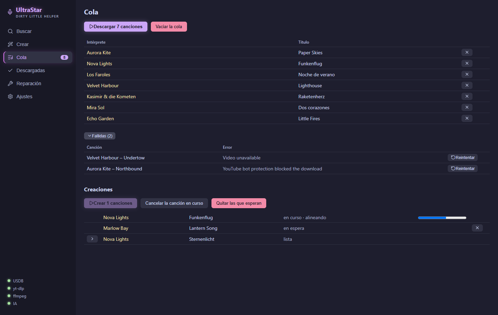

3. Puedes **cancelar** en cualquier momento (tras el lote en curso) — la cola queda guardada, también entre reinicios y caídas de la aplicación. «▶» simplemente continúa más tarde.
4. Las **descargas fallidas** van al bloque desplegable de debajo (la causa más habitual: la protección antibots de YouTube → ver [solución de problemas](#11-solución-de-problemas)). «↻ Reintentar» las devuelve a la cola; además, en la carpeta de canciones hay un `failed-downloads.xlsx` con todos los detalles.

Debajo de las descargas está el apartado **Creaciones** para las canciones que construyes tú — más en el [capítulo 9](#9-crear-canciones-tú-mismo).

## 6. La colección: filtrar, ordenar, encontrar

**Descargadas** es tu vista de lo que tienes:

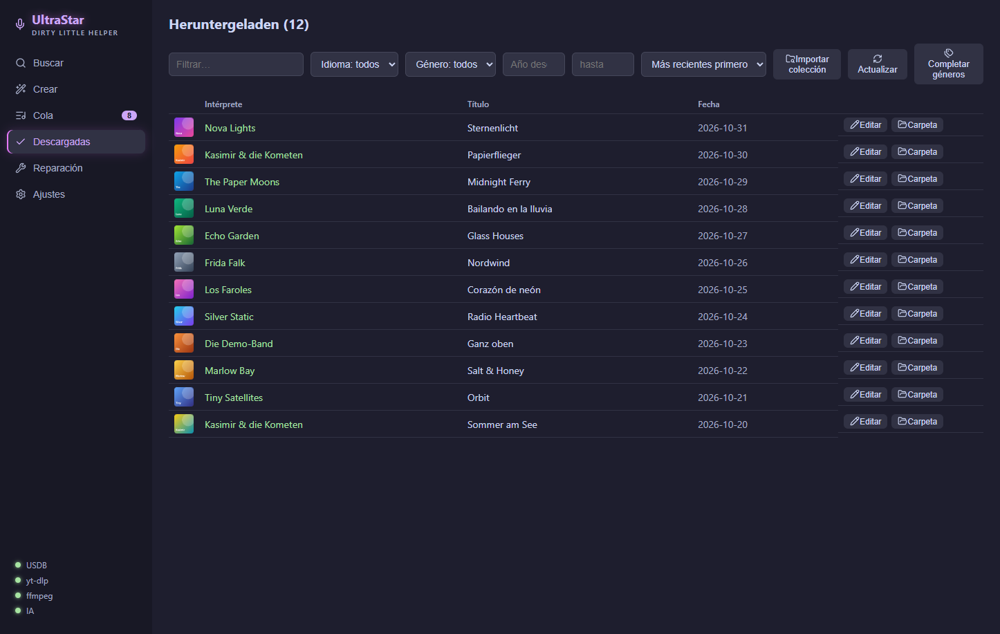

- El **filtro de texto** busca en intérprete y título.
- Los **desplegables de idioma y género** solo ofrecen valores que encajan con el resto de la selección — con el número de resultados. Las canciones en varios idiomas («Japanese, German») aparecen bajo cada uno.
- **Año desde/hasta** acota períodos («solo los 80»: 1980–1989).
- **Ordenación:** más recientes primero, intérprete A–Z, título A–Z, año ascendente.
- La lista carga más a medida que bajas («Mostrando X de Y»).
- **«Editar»** en cada fila abre la canción en el [editor de corrección](#10-corregir-notas-el-editor-de-corrección), **«Carpeta»** la abre en el explorador.
- **«Actualizar»** concilia la lista con lo que hay realmente en el disco (p. ej. tras borrar algo a mano).

## 7. Completar géneros automáticamente

Muchas canciones de USDB llegan sin género — y tus filtros se quedan igual de vacíos. La aplicación puede completar los géneros (y los años) que falten a partir de bases de datos musicales en línea:

1. Elige una **Ajustes → Fuente de géneros** y guarda:
   - **Deezer** (recomendada): sin registro, buena tasa de aciertos, alrededor de 1–2 horas para 10 000 canciones.
   - **Last.fm**: la mayor variedad de géneros, necesita una [clave de API](https://www.last.fm/api/account/create) gratuita (el campo aparece al elegirla).
   - **MusicBrainz**: base de datos abierta que encuentra canciones en parte distintas — pero limitada a una consulta por segundo (y por tanto lenta).
2. **Descargadas → «Completar géneros»**. Progreso: «Buscando géneros… (x/y · z encontrados)».
3. Puedes **cancelar en cualquier momento** — el estado queda guardado y la siguiente pasada omite las canciones ya completadas. Descargar a la vez no supone ningún problema.
4. Los géneros encontrados se normalizan (un «Hip-Hop» uniforme en lugar de «rap/hip hop» y demás), se escriben en la colección **y** como `#GENRE:` en el song.txt correspondiente — así también se ven en UltraStar Deluxe.

**Truco para la máxima cobertura:** primero una pasada completa con Deezer, después cambia la fuente a MusicBrainz y vuelve a ejecutarla — la segunda pasada solo prueba las canciones que quedaron y suele encontrar más. Lo que siga faltando normalmente no existe en esas bases de datos (remezclas, títulos de nicho) — eso puedes añadirlo a mano en el song.txt si te interesa.

## 8. Reparar vídeos

Cuando faltan vídeos o están dañados (descargas interrumpidas, archivos borrados, colecciones importadas sin vídeo):

1. **Reparación** en la barra lateral → **«Iniciar análisis»**.
2. La aplicación recorre la carpeta de descargas en busca de canciones con un `video.mp4` ausente o sospechosamente pequeño y vuelve a descargar **solo los vídeos** — las letras y las portadas quedan intactas. Las canciones sin registro de seguimiento se reconstruyen por el camino.
3. El informe final muestra reparadas / reconstruidas / irreparables. Las irreparables aparecen agrupadas por causa, cada grupo con una indicación de qué ayuda. Las canciones recién reparadas aparecen después en la colección.

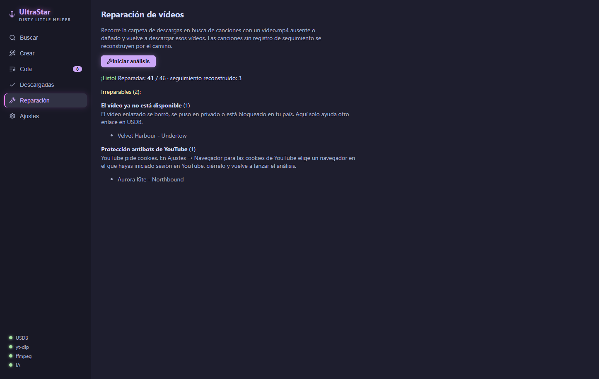

Aquí vale lo mismo: si los comentarios de USDB contienen una corrección de VIDEOGAP para el vídeo, la aplicación la lleva al song.txt automáticamente.

## 9. Crear canciones tú mismo

¿Falta una canción en USDB? La aplicación la construye por ti, a partir de una grabación y la letra. Una IA separa la voz, reconoce lo que se canta, lo coloca en el momento justo y determina los tonos. El resultado es una carpeta de canción normal con `song.txt`, audio y carátula.

**Una sola vez: preparar el entorno de IA**
1. **Ajustes → Entorno de IA (creación de canciones) → «Configurar el entorno de IA (~8 GB)»**. La aplicación descarga Python, Torch y los modelos por sí sola y comprueba si puede usar una tarjeta gráfica. Según tu conexión tarda un rato; el progreso aparece al lado.
2. El punto **«IA»** abajo a la izquierda de la barra lateral se pone verde cuando todo está listo. También funciona sin tarjeta gráfica, solo que mucho más despacio.

**Una canción en cinco pasos**: **Crear** en la barra lateral:

1. **Canción:** intérprete, título e idioma (obligatorios) y, si quieres, género, año y BPM. Deja el BPM vacío si no lo sabes: la canalización calcula el tempo por sí sola.

   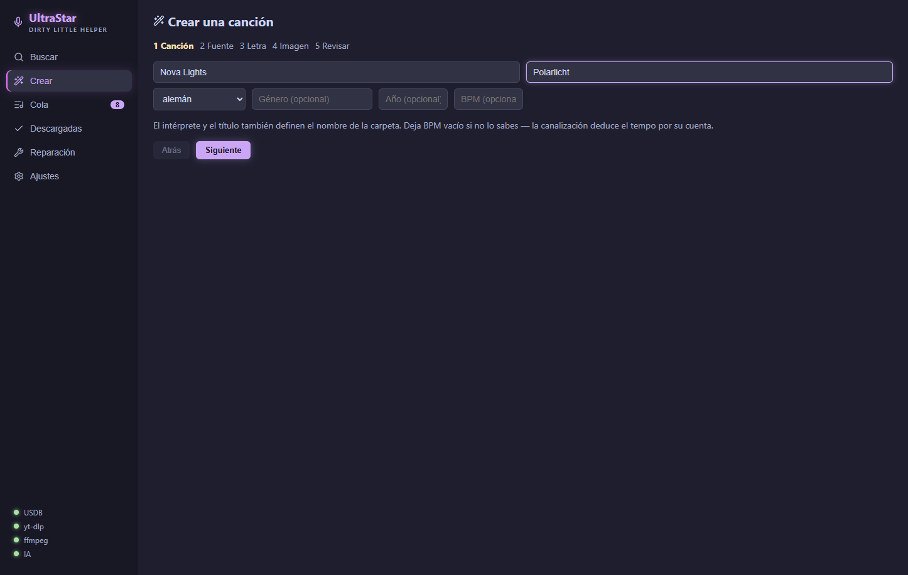

2. **Fuente:** «Buscar en YouTube» muestra cinco resultados con su duración. «Elegir» toma uno de ellos. También puedes pegar un enlace de YouTube y pulsar «Aplicar», o elegir un **archivo de audio local**.

   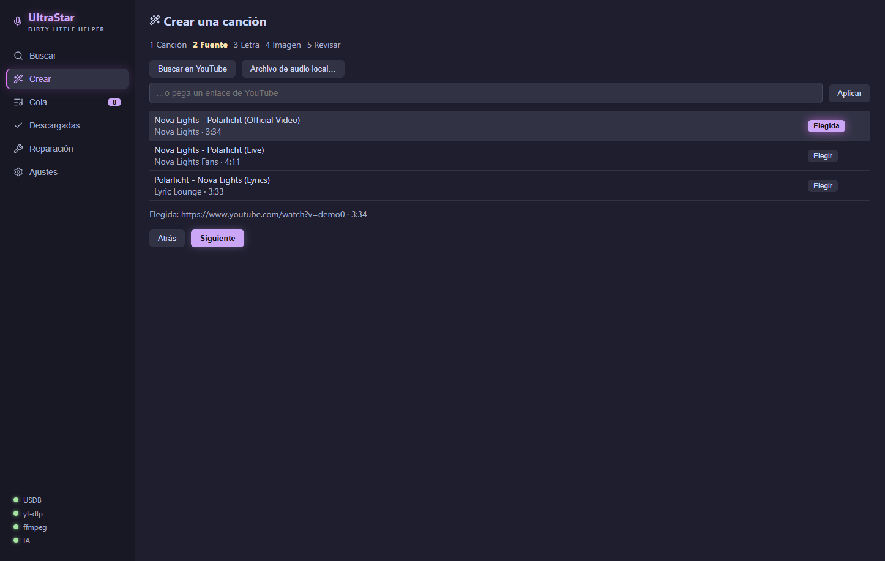

3. **Letra:** «Consultar LRCLIB» trae la letra con marcas de tiempo si existe, lo que mejora claramente la sincronización. Si no, pega la letra a mano: una línea por frase cantada, las líneas vacías separan bloques. La aplicación pregunta cuando algo no está claro (p. ej. «2x» al final de una línea o una simple referencia al estribillo).

   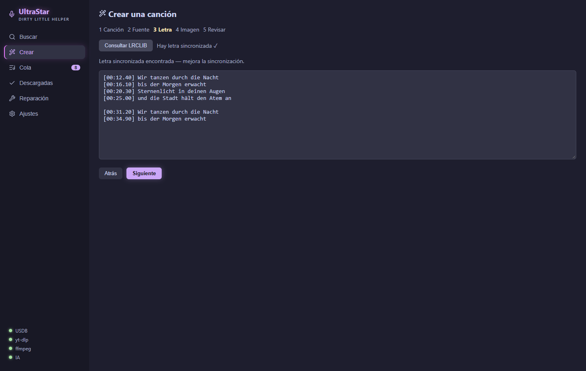

4. **Imagen:** portada del álbum, imagen de YouTube, un archivo propio o, a propósito, «Sin imagen».

   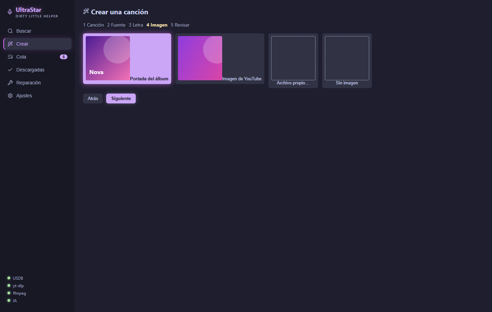

5. **Revisar:** comprueba el resumen y pulsa **«A la cola»**. Si ya hay una canción con el mismo nombre en la colección, la aplicación lo avisa; la carpeta nueva queda al lado y la antigua no se toca.

   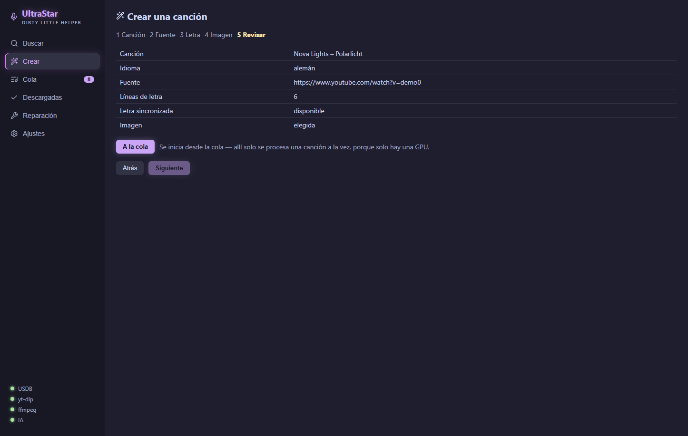

Las creaciones se inician en la **Cola**, apartado **«Creaciones»**: **«▶ Crear N canciones»**. Siempre se ejecuta una canción a la vez, con el progreso de cada etapa (separar, reconocer, alinear, tono…). «Cancelar la canción en curso» detiene solo la actual; la cola sigue con la siguiente. Cuando una canción termina, la flecha de la fila despliega los detalles: carátula, **«Editar»** en el editor de corrección y **«Abrir carpeta»**.

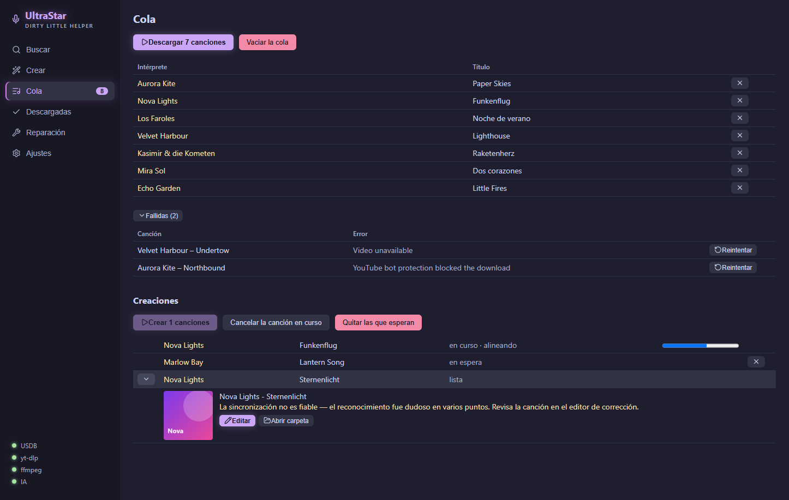

> **Con franqueza:** una creación por IA es un buen borrador, no un resultado con la calidad de USDB. Si la aplicación avisa *«La sincronización no es fiable»*, el reconocimiento fue dudoso en varios puntos y merece la pena revisarla en el [editor de corrección](#10-corregir-notas-el-editor-de-corrección).

## 10. Corregir notas: el editor de corrección

El editor ajusta la sincronización, los tonos y las sílabas de una canción, tanto si la creaste como si la descargaste. Para abrirlo: **«Editar»** en una fila de **Descargadas** o en los detalles de una creación terminada.

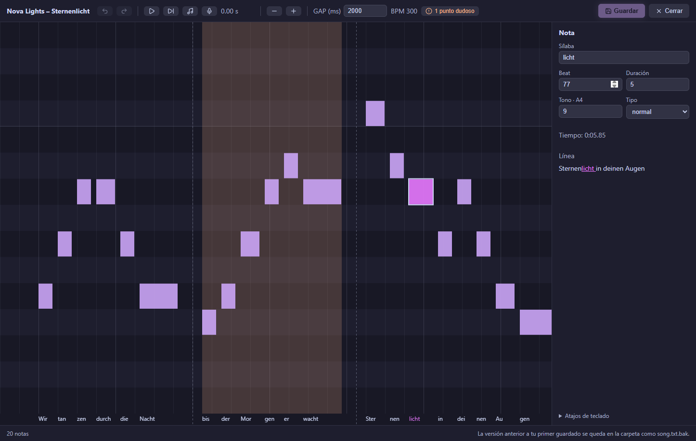

**Lo que ves:** arriba la barra de herramientas (deshacer, reproducir, reproducir la línea, tocar los tonos, cantar encima, zoom, GAP); en el centro las notas como barras: el tiempo de izquierda a derecha, el tono de abajo arriba y las sílabas debajo. Las líneas discontinuas son saltos de línea y la línea verde es la posición de reproducción. A la derecha están los valores de la nota seleccionada (sílaba, beat, duración, tono, tipo, tiempo) y su línea de letra completa, con la sílaba seleccionada resaltada.

**Cómo corregir los errores típicos:**
- **Desde cierto punto todo va adelantado o atrasado:** selecciona la nota; **Ctrl + Mayús + ← / →** la mueve junto con todo lo que sigue. Con el ratón: arrastra la nota manteniendo **Mayús**.
- **Toda la canción está desplazada:** ajusta el **GAP** de arriba (en milisegundos). Mueve todas las notas a la vez.
- **Un tono no cuadra:** **↑ / ↓** (con Mayús, una octava). Con **«Tocar los tonos de las notas»** (icono de nota o **T**) oyes los tonos sobre la grabación original al reproducir, y una nota equivocada salta a la vista enseguida. O [canta la línea encima](#cantar-encima).
- **Sílaba incorrecta:** pulsa **E**, escribe y **Intro**.
- **Nota demasiado larga o corta:** **Ctrl + ← / →**, o arrastra su borde derecho con el ratón.
- **Dos sílabas en una nota / una sílaba en dos notas:** **S** divide, **M** une con la siguiente.

Para comprobar: **P** reproduce la línea de la nota seleccionada y la **barra espaciadora** reproduce desde la posición de reproducción (un clic en un hueco la fija). Las notas con borde rojo se solapan con la anterior, casi siempre por descuido. Todos los atajos están en el editor bajo **«Atajos de teclado»**.

**Guarda** con el botón o con **Ctrl + S**. Al guardar por primera vez, el editor deja la versión original en la carpeta de la canción como `song.txt.bak`; los guardados posteriores no la sobrescriben. Para volver al original, basta con renombrarla.

**¿El archivo cambió por otro lado mientras tanto?** Si otro programa (o la función de completar géneros) cambió el `song.txt` con el editor abierto, el editor no lo sobrescribe sin más. En su lugar aparece una barra con tres salidas:

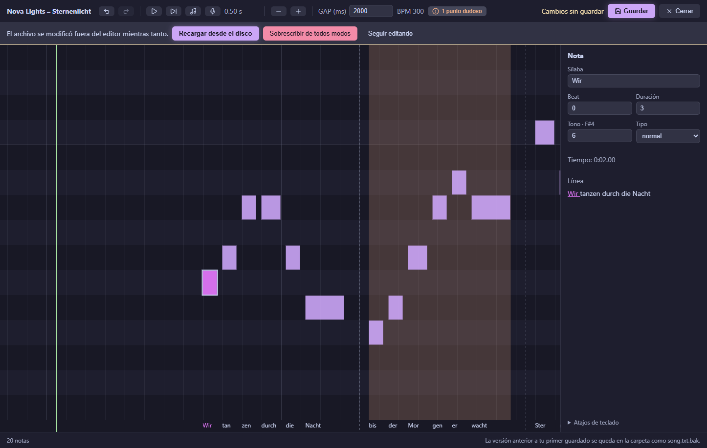

- **«Recargar desde el disco»** toma la versión más reciente del disco. Tus cambios sin guardar en el editor se pierden.
- **«Sobrescribir de todos modos»** escribe tu versión encima del archivo más reciente. Los cambios del otro programa se pierden.
- **«Seguir editando»** cierra la barra sin hacer nada — p. ej. para mirar primero qué ha cambiado.

**Puntos dudosos (solo en canciones creadas):** donde el reconocimiento tuvo dudas, hay una franja naranja detrás de las notas: intensa donde la sincronización solo se estimó, tenue donde la medición fue débil. Un botón arriba indica cuántos puntos quedan. **U** salta al siguiente y **K** lo marca como revisado. Los puntos revisados desaparecen para siempre. Estas marcas solo existen en canciones creadas con la versión 1.5 o una más reciente.

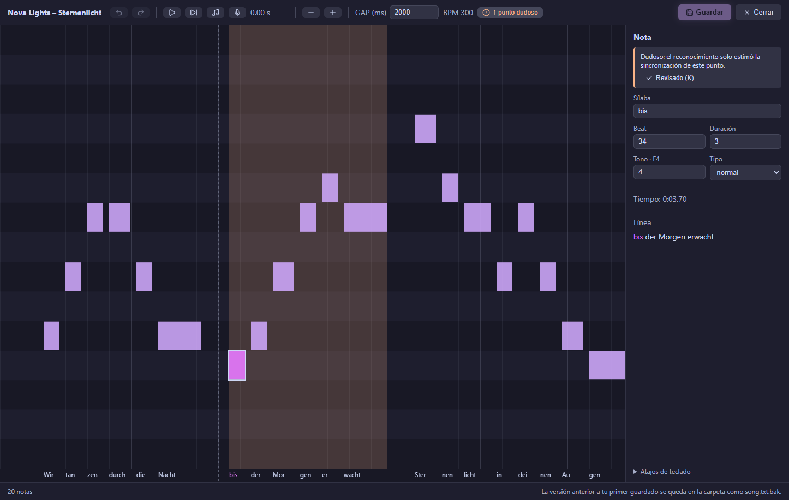

**Cantar encima:** selecciona una nota, pulsa **I** (o el icono del micrófono) y canta la línea. Tras una breve entrada, el editor reproduce la línea y escucha por el micrófono. Después muestra la línea que cantaste (en verde) y los tonos propuestos con borde discontinuo. **Intro** los aplica de una vez, **Esc** los descarta y «Otra vez» empieza de nuevo.

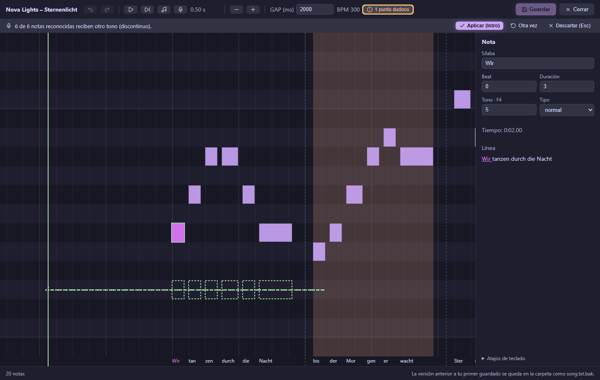

Conviene saber:
- Si cantas en otro registro que el original (p. ej. una octava más grave), el editor lo compensa: cuenta la melodía, no la octava.
- **Retardo:** el micrófono, los altavoces y tu propia reacción hacen que tu voz llegue algo más tarde de donde están las notas. El editor mide ese desfase a partir de tu toma y lo compensa. Si encuentra uno, la barra lo indica, p. ej. «Ibas 120 ms por detrás de la música; compensado.»
- Solo cambian las notas que cantaste con claridad; el resto se queda como está.
- Usa **auriculares**; si no, el micrófono también oye el original.

**Duetos:** en canciones con dos voces (`P1`/`P2`) aparecen pestañas con los nombres de los cantantes sobre las notas; **Tab** cambia de voz. La otra voz se ve tenue al fondo.

**Conviene saber:** los archivos en formato `RELATIVE` se guardan de nuevo en ese formato. Los archivos antiguos codificados en Windows-1252 se convierten a UTF-8 al guardar.

## 11. Solución de problemas

**«YouTube bot protection blocked the download» / muchos fallos seguidos**
YouTube está bloqueando las descargas anónimas. La solución: en los ajustes, elige el navegador en el que hayas **iniciado sesión** en YouTube, **cierra** ese navegador y vuelve a intentarlo («↻ Reintentar» en las fallidas). Para casos tercos: coloca un `cookies.txt` (extensión de navegador «Get cookies.txt») en la carpeta de canciones.

**El punto de estado de yt-dlp o ffmpeg sigue en rojo**
Ajustes → Herramientas → «Instalar automáticamente las herramientas que faltan». Si eso también falla (proxy corporativo o similar): instala [yt-dlp](https://github.com/yt-dlp/yt-dlp#installation) y [ffmpeg](https://www.gyan.dev/ffmpeg/builds/) a mano, añádelos al PATH y reinicia la aplicación.

**El punto de estado de IA está en rojo o en amarillo**
Rojo significa: sin configurar o dañado. Sin configurar es normal mientras no quieras crear canciones tú mismo ([capítulo 9](#9-crear-canciones-tú-mismo)). Si la configuración falló en algún paso, Ajustes → Entorno de IA muestra el último error; «Intentar de nuevo» o «Reinstalar» lo vuelve a montar. Amarillo significa: desactualizado — tras una actualización de la aplicación, el entorno también necesita actualizarse: Ajustes → Entorno de IA → «Actualizar ahora».

**Canción descargada, pero el vídeo va desfasado respecto a la letra**
Borra la carpeta de la canción, pulsa «Actualizar» en la colección y vuelve a descargarla — la aplicación toma las correcciones de VIDEOGAP de los comentarios de USDB automáticamente. Si el desfase está en la propia letra, ayuda el **GAP** del [editor de corrección](#10-corregir-notas-el-editor-de-corrección).

**La colección sigue mostrando canciones borradas / faltan carpetas nuevas**
«Actualizar» en la colección (concilia con el disco) o «Importar colección» (recoge las carpetas nuevas).

**La importación dice «X sin vídeo»**
Es normal en colecciones a las que les faltan vídeos. Esas canciones están registradas (sin descarga duplicada), pero solo aparecen en la lista tras una [reparación](#8-reparar-vídeos).

**Cantar encima: «No hay micrófono disponible»**
Comprueba que haya un micrófono conectado y que Windows permita el acceso: Configuración de Windows → Privacidad → Micrófono.

**La aplicación pide una clave de Last.fm**
Solo la fuente Last.fm necesita una — gratis en [last.fm/api/account/create](https://www.last.fm/api/account/create), o quédate simplemente con Deezer.

---

¿Preguntas, fallos, deseos? → [GitHub Issues](https://github.com/normannormalmann/ultrastar-dlh/issues)
