🇩🇪 Deutsch | 🇬🇧 [English](TUTORIAL.en.md) | 🇪🇸 [Español](TUTORIAL.es.md)

# Tutorial: UltraStar - Dirty Little Helper

Dieses Tutorial führt dich von der Installation bis zur fertig gepflegten Karaoke-Bibliothek — Schritt für Schritt. Du brauchst keine Vorkenntnisse.

> Die Bilder zeigen eine Demo-Bibliothek mit erfundenen Interpreten und Titeln. Deine App sieht genauso aus, nur mit deinen Songs.

**Inhalt**
1. [Installation & erster Start](#1-installation--erster-start)
2. [Grundeinstellungen](#2-grundeinstellungen)
3. [Bestehende Sammlung importieren](#3-bestehende-sammlung-importieren)
4. [Songs suchen und herunterladen](#4-songs-suchen-und-herunterladen)
5. [Massen-Downloads mit der Queue](#5-massen-downloads-mit-der-queue)
6. [Die Bibliothek: filtern, sortieren, finden](#6-die-bibliothek-filtern-sortieren-finden)
7. [Genres automatisch nachtragen](#7-genres-automatisch-nachtragen)
8. [Videos reparieren](#8-videos-reparieren)
9. [Songs selbst erstellen](#9-songs-selbst-erstellen)
10. [Noten korrigieren: der Korrektur-Editor](#10-noten-korrigieren-der-korrektur-editor)
11. [Problemlösung](#11-problemlösung)

---

## 1. Installation & erster Start

1. Lade die neueste `UltraStar-DLH-Setup-*.exe` von den [Releases](https://github.com/normannormalmann/ultrastar-dlh/releases) herunter. Für Linux liegt dort ein `UltraStar-DLH-*.AppImage` — ausführbar machen und starten.
2. Führe die Datei aus. Windows SmartScreen zeigt eine Warnung (die App ist nicht signiert): klicke **„Weitere Informationen" → „Trotzdem ausführen"**. Die Installation läuft ohne weitere Fragen durch und startet die App.
3. Beim ersten Start passiert automatisch:
   - Die App legt ein anonymes **USDB-Konto** an und meldet sich an.
   - Fehlen **yt-dlp** oder **ffmpeg**, lädt die App beide selbst herunter. Du musst nichts tun.

Links siehst du die Seitenleiste mit allen Bereichen, unten die **Status-Punkte**: USDB-Anmeldung, yt-dlp, ffmpeg und KI (die KI-Umgebung für das [Erstellen eigener Songs](#9-songs-selbst-erstellen)). Grün heißt startklar, gelb heißt „wird noch geprüft“. Der KI-Punkt bleibt rot, bis du die KI-Umgebung einrichtest — für Suchen und Herunterladen brauchst du sie nicht, der rote Punkt stört dabei nicht.

> **Updates:** Die App meldet sich selbst, wenn eine neue Version vorliegt: **Einstellungen → App → „Auf Updates prüfen"**, herunterladen, **„Neu starten und installieren"**. Weil der Installer nicht signiert ist, fragt SmartScreen auch beim Update noch einmal. Von Hand geht es weiterhin: Eine neue Version installierst du einfach über die alte — Einstellungen, Bibliothek und Queue bleiben erhalten.

## 2. Grundeinstellungen

Öffne **Einstellungen** (Zahnrad in der Seitenleiste):

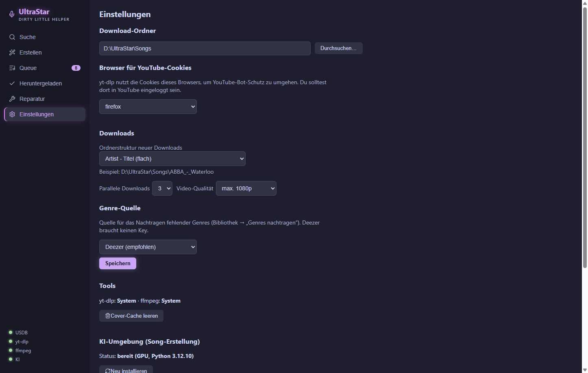

- **Download-Ordner:** Der Ordner, in dem deine Songs liegen (sollen) — z.B. `D:\UltraStar\Songs`. Über „Durchsuchen…" wählbar. *Das ist derselbe Ordner, den du in Melody Mania als Song-Ordner bzw. in UltraStar Deluxe als SongDir einträgst.*
- **Browser für YouTube-Cookies:** Wähle den Browser, in dem du bei YouTube **angemeldet** bist (z.B. Edge, Chrome oder Firefox). YouTube blockiert anonyme Downloads häufig; mit deinen Browser-Cookies umgeht die App das. Wichtig beim Herunterladen: Browser schließen, sonst ist seine Cookie-Datenbank gesperrt.
- **Downloads:**
  - *Ordnerstruktur neuer Downloads* — wie neue Songs abgelegt werden:
    - `Artist - Titel` (flach): alles in einer Ebene — Standard.
    - `Artist / Artist - Titel`: ein Unterordner je Interpret.
    - `A / Artist - Titel`: Unterordner nach Anfangsbuchstabe.
    Die Beispielzeile darunter zeigt den Pfad live. UltraStar Deluxe kommt mit allen Varianten (auch gemischt) klar; bereits vorhandene Songs werden nicht verschoben.
  - *Parallele Downloads* (1–5): Wie viele Songs gleichzeitig laden. 2–3 ist ein guter Standard.
  - *Video-Qualität*: max. 720p spart Platz, max. 1080p ist Standard, „Beste verfügbare" nimmt, was YouTube hergibt.
- **Genre-Quelle:** siehe [Kapitel 7](#7-genres-automatisch-nachtragen).

**„Speichern"** unter der Genre-Quelle übernimmt diese Einstellungen — und auch die Sprache (siehe unten).

Weiter unten stehen diese Bereiche:

- **Tools:** Woher yt-dlp und ffmpeg kommen („System" = schon installiert, „App-verwaltet" = von der App geladen). Fehlt eines, holt **„Fehlende Tools automatisch installieren"** es nach. **„Cover-Cache leeren"** löscht zwischengespeicherte Vorschaubilder der Suche.
- **KI-Umgebung (Song-Erstellung):** Status und Einrichtung, siehe [Kapitel 9](#9-songs-selbst-erstellen).
- **App:** installierte Version und **„Auf Updates prüfen"**.
- **Sprache:** Deutsch, Englisch oder Spanisch. Die Oberfläche wechselt sofort; dauerhaft gespeichert wird die Wahl mit „Speichern" weiter oben. Ohne eigene Wahl folgt die App der Sprache deines Systems.

## 3. Bestehende Sammlung importieren

Du hast schon Songs auf der Platte? Dann zuerst importieren — sonst kennt die App deinen Bestand nicht und würde Songs doppelt herunterladen.

1. Stelle sicher, dass der **Download-Ordner** (Kapitel 2) auf deine Sammlung zeigt.
2. Öffne **Heruntergeladen** in der Seitenleiste → klicke **„Archiv importieren"**.
3. Die App scannt alle Song-Ordner (auch eine Ebene verschachtelt, z.B. `ABBA\ABBA - Waterloo\`) und übernimmt jeden Ordner mit einer `song.txt` — **ohne irgendetwas herunterzuladen**. Bei großen Sammlungen (10.000+) dauert das einige Minuten; ein Fortschrittsbalken zeigt den Stand.
4. Ergebnis-Meldung lesen: „N Songs importiert (davon X ohne Video — Reparatur ausführen) · M bereits vorhanden". Songs **ohne Video** erscheinen erst nach einer [Reparatur](#8-videos-reparieren) in der Liste, sind aber bereits gegen Doppel-Downloads geschützt.

**Gut zu wissen:**
- Der Import liest Sprache, Genre, Jahr & Co. direkt aus den song.txt-Dateien — deine Filter funktionieren sofort.
- Ein **erneuter** Klick auf „Archiv importieren" schadet nie: Er findet neue Ordner und ergänzt fehlende Metadaten bei bereits importierten Einträgen.
- Hast du Ordner außerhalb der App gelöscht oder geändert: **„Aktualisieren"** klicken — die App prüft den Bestand neu.

## 4. Songs suchen und herunterladen

1. Öffne **Suche** (Lupe). Gib Interpret und/oder Titel ein, `Enter` oder „Suchen".
2. Die Tabelle zeigt Cover, Interpret, Titel, Sprachen, Bewertung (★) und Views. Bereits vorhandene Songs tragen ein grünes **✓** — bei ihnen gibt es nichts zu tun.

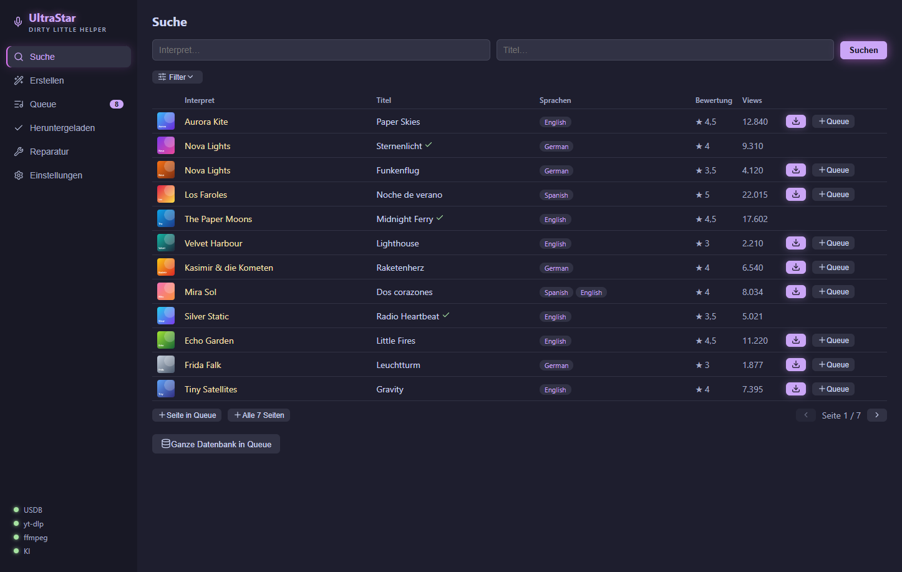

3. **Filter** aufklappen (Schieberegler-Symbol) für mehr Kontrolle:
   - **Sprache, Genre, Jahr** — filtern serverseitig über die *gesamte* Datenbank, nicht nur die aktuelle Seite.
   - **Sortierung** + Richtung (z.B. „Bewertung absteigend" für die beliebtesten zuerst).
   - **Nur Golden Notes / Nur Songcheck** — Qualitätsmerkmale der Datenbank.
   - **Bestand:** „Nur fehlende" blendet aus, was du schon hast — perfekt zum Stöbern nach Neuem.
   - Filteränderungen suchen automatisch neu (ein kleiner Zähler am Filter-Knopf zeigt aktive Filter).

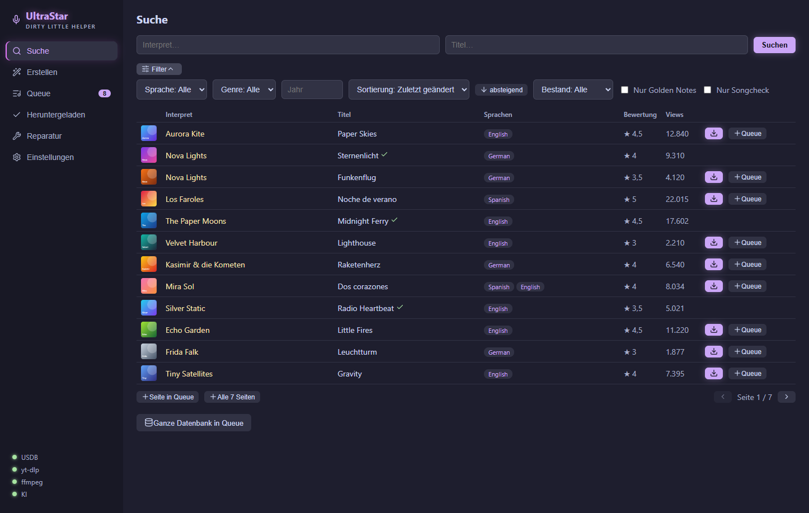

4. **Herunterladen:** Der ⬇-Knopf an der Zeile lädt den Song sofort. Unten erscheint die Download-Leiste mit Fortschritt. Ein kompletter Song (Text + Cover + Video) dauert je nach Video meist unter einer Minute.

Der fertige Song liegt danach als Ordner in deinem Download-Ordner — mit `song.txt`, `cover.jpg` und `video.mp4` — und ist sofort in UltraStar Deluxe singbar (dort ggf. „Songs neu einlesen").

## 5. Massen-Downloads mit der Queue

Für alles, was mehr als ein paar Songs sind:

1. In der Suche sammeln:
   - **„＋ Queue"** an der Zeile: einzelner Song.
   - **„＋ Seite in Queue"**: alle (sichtbaren) Treffer der aktuellen Seite.
   - **„＋ Alle N Seiten"**: *jede* Seite der aktuellen Suche — z.B. „Sprache: German, Genre: Schlager" komplett. Respektiert alle aktiven Filter.
   - **„Ganze Datenbank in Queue"**: wirklich alles (zehntausende Songs — Bestätigungsdialog).
   Bereits vorhandene oder schon eingereihte Songs werden automatisch übersprungen; der Zähler an „Queue" in der Seitenleiste wächst entsprechend.
2. Öffne **Queue** → **„▶ N Songs herunterladen"**. Die App arbeitet die Liste mit der eingestellten Parallelität ab.

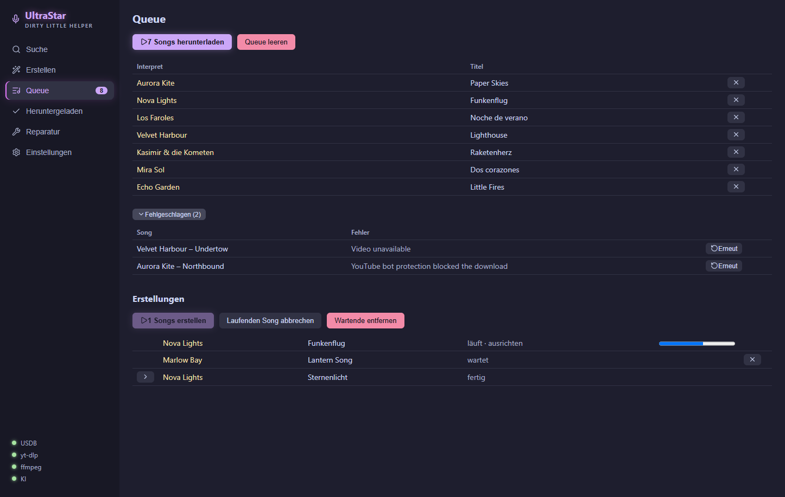

3. Du kannst jederzeit **abbrechen** (nach dem laufenden Schwung) — die Queue bleibt gespeichert, auch über App-Neustarts und Abstürze hinweg. „▶" macht später einfach weiter.
4. **Fehlgeschlagene Downloads** landen im aufklappbaren Bereich darunter (häufigste Ursache: YouTube-Bot-Schutz → siehe [Problemlösung](#11-problemlösung)). „↻ Erneut" legt sie wieder in die Queue; zusätzlich liegt im Songs-Ordner eine `failed-downloads.xlsx` mit allen Details.

Unter den Downloads steht der Bereich **Erstellungen** für selbst gebaute Songs — mehr dazu in [Kapitel 9](#9-songs-selbst-erstellen).

## 6. Die Bibliothek: filtern, sortieren, finden

**Heruntergeladen** ist deine Bestandsansicht:

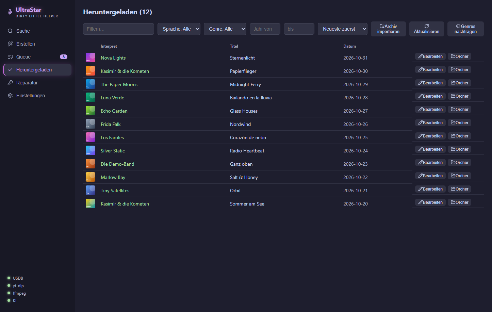

- **Textfilter** sucht in Interpret und Titel.
- **Sprache/Genre-Dropdowns** zeigen nur Werte, die zur restlichen Auswahl passen — inklusive Trefferzahlen. Songs mit mehreren Sprachen („Japanese, German") erscheinen unter beiden.
- **Jahr von/bis** grenzt Zeiträume ein („nur 80er": 1980–1989).
- **Sortierung:** Neueste zuerst, Interpret A–Z, Titel A–Z, Jahr aufsteigend.
- Die Liste lädt beim Scrollen automatisch nach („X von Y angezeigt").
- **„Bearbeiten"** an jeder Zeile öffnet den Song im [Korrektur-Editor](#10-noten-korrigieren-der-korrektur-editor), **„Ordner"** öffnet ihn im Explorer.
- **„Aktualisieren"** gleicht die Liste mit dem tatsächlichen Plattenbestand ab (z.B. nach manuellem Löschen).

## 7. Genres automatisch nachtragen

Viele USDB-Songs kommen ohne Genre — entsprechend leer bleiben deine Filter. Die App kann fehlende Genres (und Jahre) aus Online-Musikdatenbanken nachtragen:

1. **Einstellungen → Genre-Quelle** wählen und speichern:
   - **Deezer** (empfohlen): ohne Anmeldung, gute Trefferquote, ~1–2 Stunden für 10.000 Songs.
   - **Last.fm**: beste Genre-Vielfalt, braucht einen kostenlosen [API-Key](https://www.last.fm/api/account/create) (Feld erscheint bei Auswahl).
   - **MusicBrainz**: offene Datenbank, findet teils andere Songs — aber limitiert auf 1 Anfrage/Sekunde (entsprechend langsam).
2. **Heruntergeladen → „Genres nachtragen"**. Fortschritt: „Suche Genres… (x/y · z gefunden)".
3. Du kannst **jederzeit abbrechen** — der Stand ist gespeichert, der nächste Lauf überspringt bereits angereicherte Songs. Downloads parallel zum Lauf sind kein Problem.
4. Gefundene Genres werden normalisiert (einheitlich „Hip-Hop" statt „rap/hip hop" etc.), in die Bibliothek **und** als `#GENRE:` in die jeweilige song.txt geschrieben — sie sind also auch in UltraStar Deluxe sichtbar.

**Tipp für maximale Abdeckung:** Erst ein Deezer-Volllauf, danach die Quelle auf MusicBrainz stellen und erneut laufen lassen — der zweite Lauf probiert nur die übrig gebliebenen Songs und findet oft weitere. Was dann noch fehlt, existiert in den Datenbanken meist schlicht nicht (Remixe, Nischen-Titel) — das kannst du bei Bedarf von Hand in der song.txt ergänzen.

## 8. Videos reparieren

Wenn Videos fehlen oder defekt sind (abgebrochene Downloads, gelöschte Dateien, importierte Bestände ohne Video):

1. **Reparatur** in der Seitenleiste → **„Scan starten"**.
2. Die App durchsucht den Download-Ordner nach Songs mit fehlendem oder verdächtig kleinem `video.mp4` und lädt **nur die Videos** neu — Texte und Cover bleiben unberührt. Songs ohne Tracking-Eintrag werden dabei rekonstruiert.
3. Der Abschlussbericht zeigt repariert / rekonstruiert / nicht reparierbar. Nicht reparierbare Songs sind nach Ursache gruppiert, jeweils mit einem Hinweis, was hilft. Frisch reparierte Songs erscheinen danach in der Bibliothek.

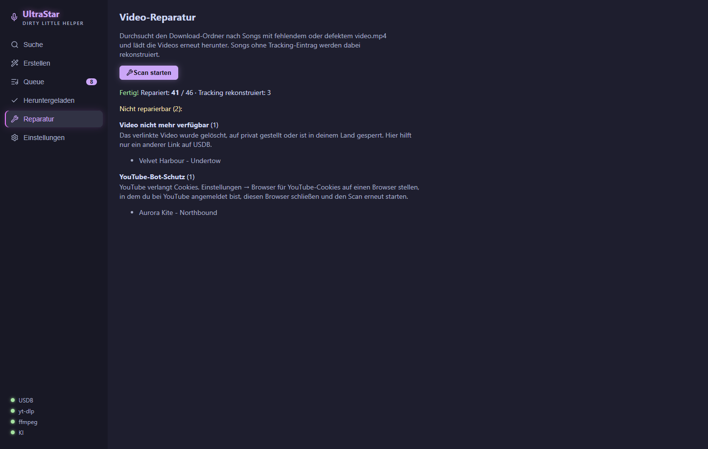

Auch hier gilt: Steht in den USDB-Kommentaren eine VIDEOGAP-Korrektur zum Video, übernimmt die App sie automatisch in die song.txt.

## 9. Songs selbst erstellen

Ein Song fehlt auf USDB? Die App baut ihn dir selbst — aus einer Aufnahme und dem Liedtext. Eine KI trennt die Stimme ab, erkennt den gesungenen Text, legt ihn auf die richtigen Zeitpunkte und bestimmt die Tonhöhen. Heraus kommt ein normaler Song-Ordner mit `song.txt`, Audio und Cover.

**Einmalig: die KI-Umgebung einrichten**
1. **Einstellungen → KI-Umgebung (Song-Erstellung) → „KI-Umgebung einrichten (~8 GB)"**. Die App lädt Python, Torch und die Modelle selbst herunter und erkennt dabei, ob eine Grafikkarte genutzt werden kann. Das dauert je nach Leitung eine Weile — der Fortschritt steht daneben.
2. Der Punkt **„KI"** unten links in der Seitenleiste wird grün, sobald alles steht. Ohne Grafikkarte funktioniert es auch, nur deutlich langsamer.

**Ein Song in fünf Schritten** — **Erstellen** in der Seitenleiste:

1. **Song:** Interpret, Titel und Sprache (Pflicht), dazu optional Genre, Jahr und BPM. BPM leer lassen, wenn du es nicht weißt — die Pipeline ermittelt das Tempo selbst.

   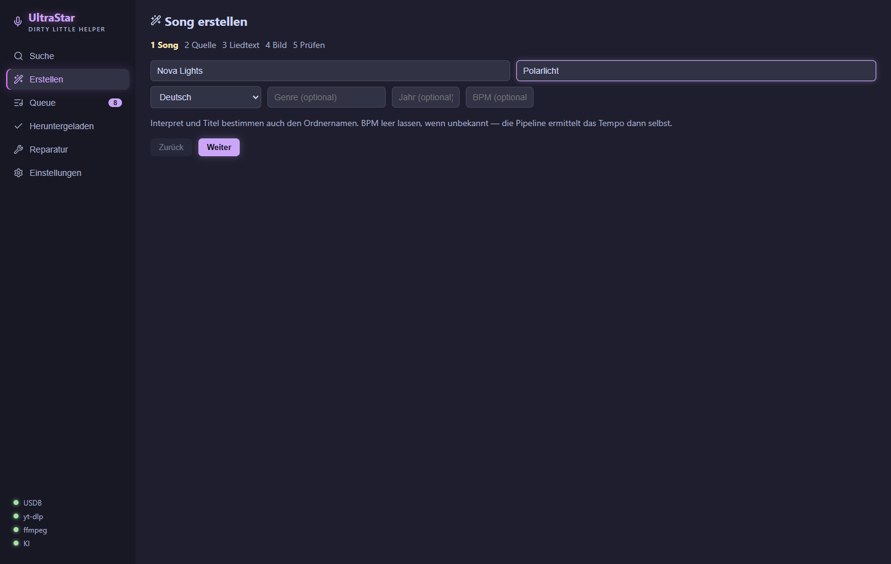

2. **Quelle:** „Bei YouTube suchen" zeigt fünf Treffer mit Dauer. „Wählen" übernimmt einen davon. Alternativ einen YouTube-Link einfügen und „Übernehmen" klicken oder eine **lokale Audiodatei** wählen.

   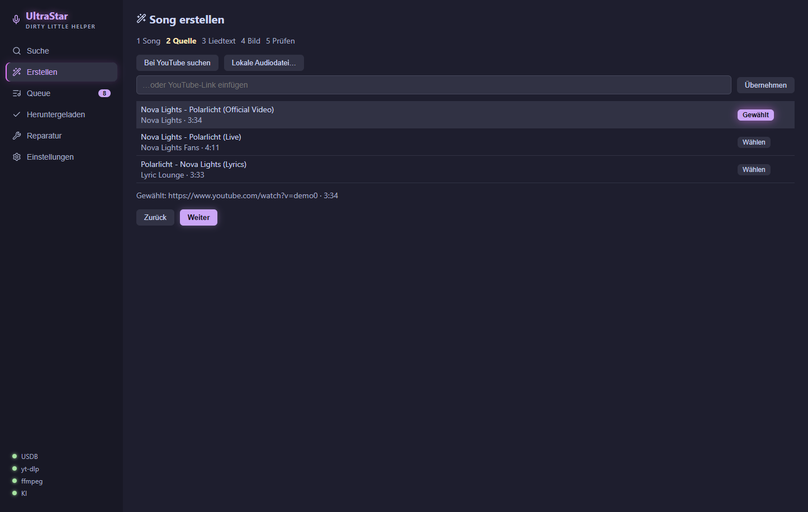

3. **Liedtext:** „Bei LRCLIB nachsehen" holt den Text samt Zeitstempeln, wenn es ihn gibt — das verbessert das Timing spürbar. Sonst den Text von Hand einfügen: eine Zeile pro gesungener Phrase, Leerzeilen trennen Blöcke. Die App fragt nach, wenn etwas unklar ist (z.B. „2x" am Zeilenende oder ein bloßer Refrain-Verweis).

   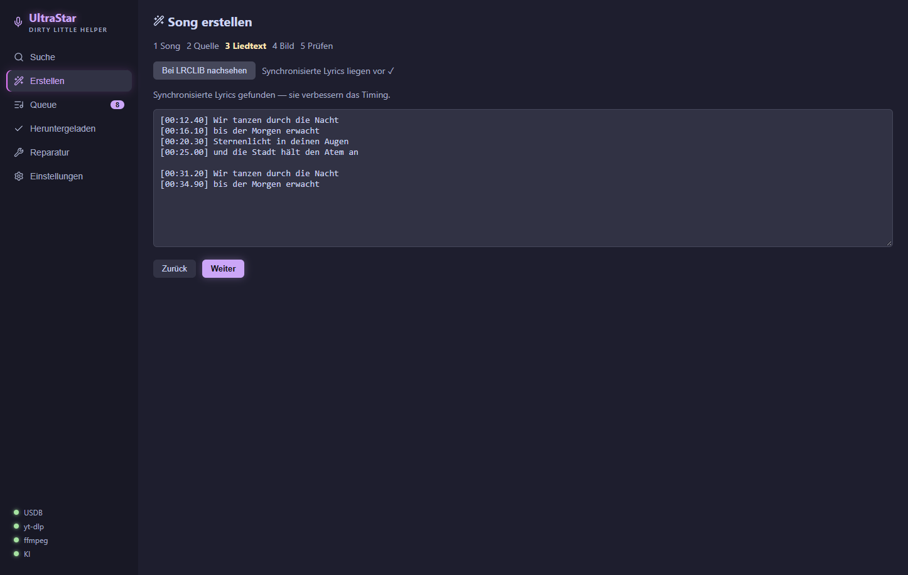

4. **Bild:** Album-Cover, YouTube-Bild, eigene Datei — oder bewusst „Kein Bild".

   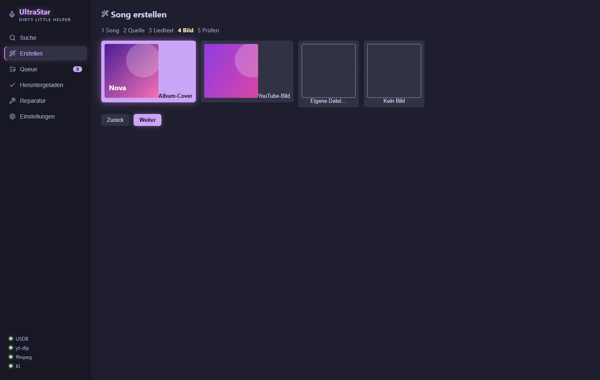

5. **Prüfen:** Zusammenfassung ansehen, **„Zur Queue"**. Liegt ein Song mit gleichem Namen schon in der Bibliothek, weist die App darauf hin; der neue Ordner landet dann daneben, der alte bleibt unberührt.

   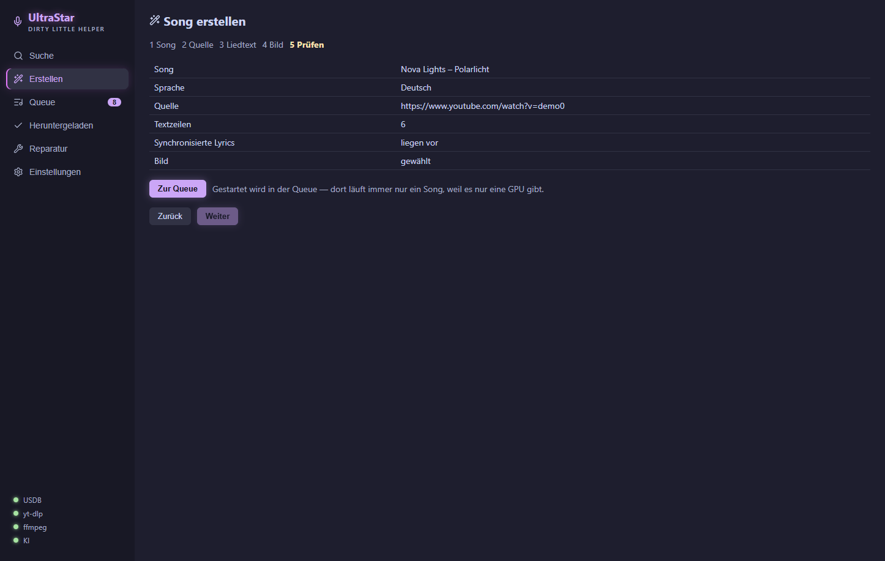

Gestartet wird in der **Queue**, Abschnitt **„Erstellungen"**: **„▶ N Songs erstellen"**. Dort läuft immer nur ein Song zur Zeit, mit Fortschritt je Stufe (trennen, erkennen, ausrichten, Tonhöhe …). „Laufenden Song abbrechen" stoppt nur den aktuellen, die Queue macht mit dem nächsten weiter. Ist ein Song fertig, klappt der Pfeil an der Zeile die Details auf: Cover, **„Bearbeiten"** im Korrektur-Editor und **„Ordner öffnen"**.

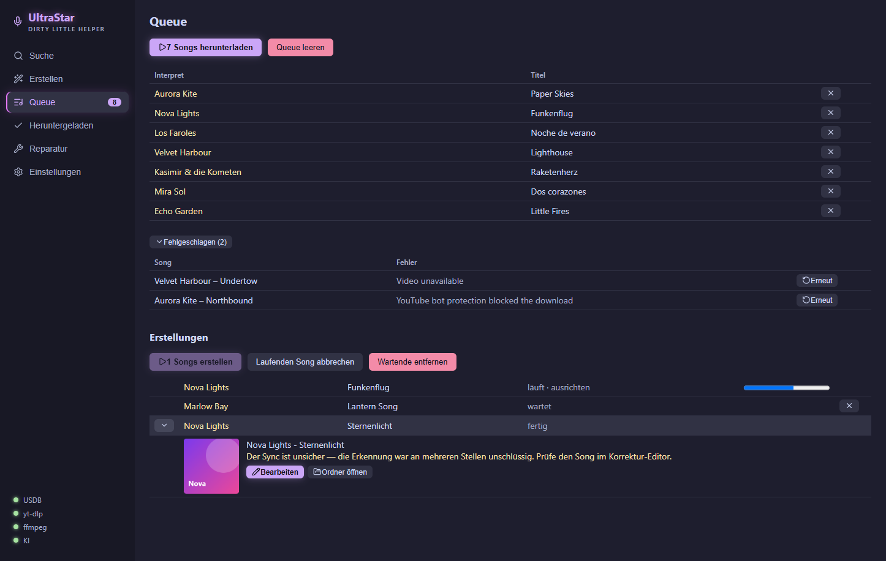

> **Ehrlich gesagt:** Eine KI-Erstellung ist ein guter Rohbau, kein fertiges USDB-Niveau. Meldet die App *„Der Sync ist unsicher"*, war die Erkennung an mehreren Stellen unschlüssig — dann lohnt ein Blick in den [Korrektur-Editor](#10-noten-korrigieren-der-korrektur-editor).

## 10. Noten korrigieren: der Korrektur-Editor

Mit dem Editor ziehst du Timing, Tonhöhen und Silben eines Songs gerade — egal ob selbst erstellt oder heruntergeladen. Öffnen: **„Bearbeiten"** an einer Zeile in **Heruntergeladen** oder in den Details einer fertigen Erstellung.

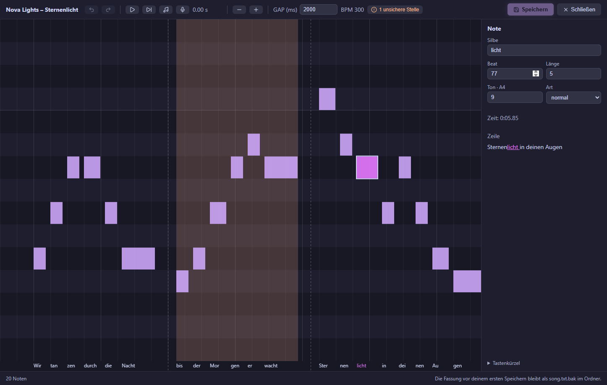

**Was du siehst:** Oben die Werkzeugleiste (Rückgängig, Abspielen, Zeile anspielen, Töne mitspielen, Einsingen, Zoom, GAP), in der Mitte die Noten als Balken — links nach rechts die Zeit, unten nach oben die Tonhöhe, darunter die Silben. Gestrichelte Linien sind Zeilenumbrüche, die grüne Linie ist die Abspielposition. Rechts stehen die Werte der gewählten Note (Silbe, Beat, Länge, Ton, Art, Zeit) und die ganze Textzeile mit der gewählten Silbe hervorgehoben.

**So korrigierst du typische Fehler:**
- **Alles ab einer Stelle zu früh oder zu spät:** Note wählen, **Strg + Umschalt + ← / →** verschiebt sie und alles danach. Mit der Maus: Note mit gedrückter **Umschalt**-Taste ziehen.
- **Der ganze Song ist versetzt:** Den **GAP** oben anpassen (in Millisekunden). Er verschiebt alle Noten gleichzeitig.
- **Ein Ton stimmt nicht:** **↑ / ↓** (mit Umschalt um eine Oktave). Mit **„Töne mitspielen"** (Noten-Symbol oder **T**) hörst du beim Abspielen die Notentöne über dem Original — so fällt ein falscher Ton sofort auf. Oder du [singst die Zeile ein](#einsingen).
- **Silbe falsch:** **E** drücken, tippen, **Enter**.
- **Note zu lang oder zu kurz:** **Strg + ← / →** oder die rechte Kante mit der Maus ziehen.
- **Zwei Silben auf einer Note / eine Silbe auf zwei Noten:** **S** teilt, **M** verbindet mit der nächsten.

Zum Prüfen: **P** spielt die Zeile der gewählten Note an, die **Leertaste** spielt ab der Abspielposition (Klick ins Leere setzt sie). Rot umrandete Noten überlappen ihre Vorgängerin — meist ein Versehen. Alle Tastenkürzel stehen im Editor unter **„Tastenkürzel"**.

**Speichern** mit dem Knopf oder **Strg + S**. Beim ersten Speichern legt der Editor die ursprüngliche Fassung als `song.txt.bak` in den Song-Ordner; spätere Speichervorgänge überschreiben sie nicht. Willst du zurück zum Original, benennst du sie einfach zurück.

**Datei inzwischen anderweitig geändert?** Hat ein anderes Programm (oder das Nachtragen von Genres) die `song.txt` geändert, während der Editor offen war, speichert der Editor nicht einfach drüber. Stattdessen erscheint eine Leiste mit drei Wegen:

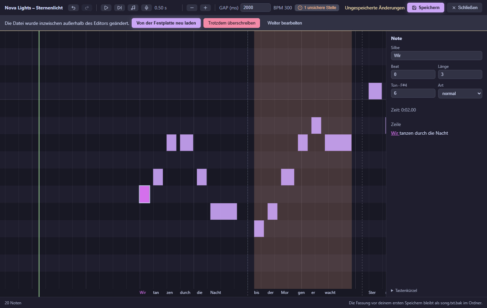

- **„Von der Festplatte neu laden"** übernimmt die neuere Fassung von der Platte. Deine ungespeicherten Änderungen im Editor gehen dabei verloren.
- **„Trotzdem überschreiben"** schreibt deine Fassung über die neuere Datei. Die Änderungen des anderen Programms gehen verloren.
- **„Weiter bearbeiten"** schließt die Leiste, ohne etwas zu tun — z.B. um erst nachzusehen, was sich geändert hat.

**Unsichere Stellen (nur bei selbst erstellten Songs):** Wo die Erkennung gezweifelt hat, liegt ein orangefarbenes Band hinter den Noten — kräftig, wo das Timing nur geschätzt ist, blass, wo die Messung schwach war. Oben zeigt ein Knopf, wie viele Stellen offen sind. **U** springt zur nächsten, **K** hakt sie als geprüft ab. Abgehakte Stellen verschwinden dauerhaft. Diese Markierungen gibt es nur für Songs, die mit Version 1.5 oder neuer erstellt wurden.

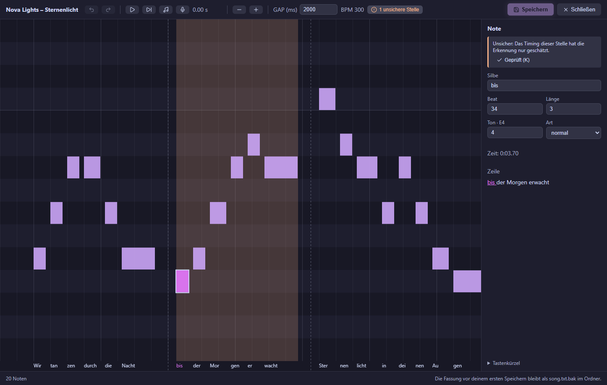

**Einsingen:** Note wählen, **I** drücken (oder das Mikrofon-Symbol) und die Zeile mitsingen. Nach einem kurzen Vorlauf spielt der Editor die Zeile ab und hört über das Mikrofon zu. Danach zeigt er deine gesungene Linie (grün) und die vorgeschlagenen Töne gestrichelt. **Enter** übernimmt sie in einem Schritt, **Esc** verwirft sie, „Nochmal" startet neu.

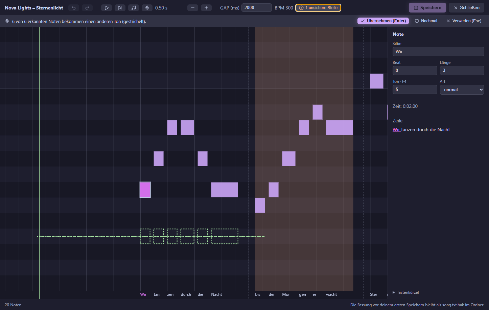

Gut zu wissen:
- Singst du in einer anderen Lage als das Original (z. B. eine Oktave tiefer), gleicht der Editor das aus — die Melodie zählt, nicht die Oktave.
- **Verzögerung:** Mikrofon, Lautsprecher und deine eigene Reaktion lassen deinen Gesang etwas später ankommen, als die Noten stehen. Der Editor misst diesen Versatz aus deiner Aufnahme selbst und gleicht ihn aus. Wenn er einen gefunden hat, steht er in der Leiste, z. B. „Dein Einsatz lag 120 ms hinter der Musik — ausgeglichen."
- Nur Noten, die du deutlich gesungen hast, werden geändert; der Rest bleibt, wie er ist.
- **Kopfhörer** verwenden, sonst hört das Mikrofon das Original mit.

**Duette:** Bei Songs mit zwei Stimmen (`P1`/`P2`) erscheinen über den Noten Reiter mit den Sängernamen; **Tab** wechselt die Stimme. Die jeweils andere Stimme ist blass im Hintergrund zu sehen.

**Gut zu wissen:** Dateien im `RELATIVE`-Format werden im selben Format zurückgeschrieben. Ältere Dateien in Windows-1252-Kodierung werden beim Speichern in UTF-8 umgewandelt.

## 11. Problemlösung

**„YouTube bot protection blocked the download" / viele Fehlschläge hintereinander**
YouTube blockiert anonyme Downloads. Lösung: In den Einstellungen den Browser wählen, in dem du bei YouTube **eingeloggt** bist, den Browser **schließen**, dann erneut versuchen (Fehlgeschlagene per „↻ Erneut"). Hartnäckige Fälle: eine `cookies.txt` (Browser-Erweiterung „Get cookies.txt") in den Songs-Ordner legen.

**Status-Punkt yt-dlp/ffmpeg bleibt rot**
Einstellungen → Tools → „Fehlende Tools automatisch installieren". Schlägt auch das fehl (Firmen-Proxy o.ä.): [yt-dlp](https://github.com/yt-dlp/yt-dlp#installation) und [ffmpeg](https://www.gyan.dev/ffmpeg/builds/) manuell installieren, in den PATH aufnehmen, App neu starten.

**Status-Punkt KI ist rot oder gelb**
Rot heißt: nicht eingerichtet oder defekt. Nicht eingerichtet ist normal, solange du keine Songs selbst erstellen willst ([Kapitel 9](#9-songs-selbst-erstellen)). Ist die Einrichtung an einem Schritt gescheitert, zeigt Einstellungen → KI-Umgebung den letzten Fehler; „Erneut versuchen" oder „Neu installieren" setzt sie neu auf. Gelb heißt: veraltet — nach einem App-Update braucht die Umgebung eine Aktualisierung: Einstellungen → KI-Umgebung → „Jetzt aktualisieren".

**Song heruntergeladen, aber Video läuft versetzt zum Text**
Song-Ordner löschen, in der Bibliothek „Aktualisieren", Song neu herunterladen — die App übernimmt VIDEOGAP-Korrekturen aus den USDB-Kommentaren automatisch. Liegt der Versatz am Text selbst, hilft der **GAP** im [Korrektur-Editor](#10-noten-korrigieren-der-korrektur-editor).

**Bibliothek zeigt gelöschte Songs noch an / neue Ordner fehlen**
„Aktualisieren" in der Bibliothek (gleicht mit der Platte ab) bzw. „Archiv importieren" (nimmt neue Ordner auf).

**Import meldet „X ohne Video"**
Normal bei Beständen mit fehlenden Videos. Diese Songs sind getrackt (kein Doppel-Download), erscheinen aber erst nach einer [Reparatur](#8-videos-reparieren) in der Liste.

**Einsingen: „Kein Mikrofon verfügbar"**
Prüfe, ob ein Mikrofon angeschlossen ist und Windows den Zugriff erlaubt: Windows-Einstellungen → Datenschutz → Mikrofon.

**Die App fragt nach einem Last.fm-Key**
Nur die Quelle Last.fm braucht einen — kostenlos unter [last.fm/api/account/create](https://www.last.fm/api/account/create), oder einfach bei Deezer bleiben.

---

Fragen, Fehler, Wünsche? → [GitHub Issues](https://github.com/normannormalmann/ultrastar-dlh/issues)
